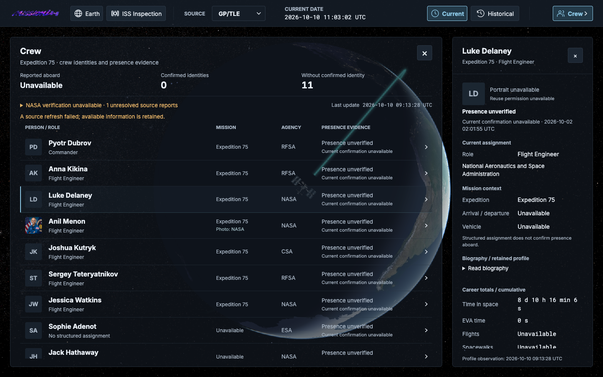
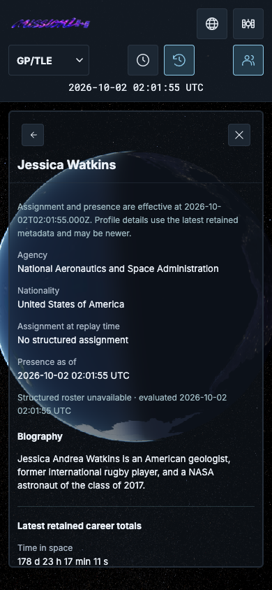

# Canonical Crew identity validation — 2026-10-10

Accepted baseline: `fb7cf6be8af4bd1a38d9e17ff2123011512d6144`, checkout `/Users/daniel/Desktop/MISSION1`, branch `main`. ADR-0013 and V7 implement the reviewed Luke Delaney / Jessica Watkins equivalence and shared retained-profile projection.

## Maintenance acceptance

Dry-run resolved four provider keys into exactly two proposed pairs, zero pending and no conflicts. Existing table fingerprints were unchanged except the additive Flyway history row; decision/proof tables stayed empty. V1–V6 SQL files remain byte-identical to baseline.

| Human | Canonical UUID | Retained alias UUID |
|---|---|---|
| Luke Delaney | 09dea926-7480-4fc5-a340-01d44a6e5dae | 9cd14c46-8b34-41b7-9fec-5ea736fa974b |
| Jessica Watkins | 6e700f29-14ab-415a-87e4-6567860c1796 | b4932ff9-75e7-4eb4-b8c1-0362acb27356 |

Apply recorded two active equivalences, four active bindings and39 bounded proof rows, at `knownAt=2026-10-10T10:44:20.191839Z`. Proof includes retained operational-evidence lineage and exact official/LL2 capture identifiers. Final-jar restart reported zero proposals, two already active, zero pending; decision/proof rows remained identical.

The database retains13 anchors,16 original mappings and11 canonical classes. Every original Crew table retains its count/row fingerprint through final validation:11 LL2 snapshots,77 profile/77 assignment observations, five NASA evidence versions,18 subject rows,20 resolution audits, four V6 assertions,11 logical subjects and12 subject metadata versions. Evidence4/12 and Fedyaev logical subject `96907d0d3747443d9308c09c7ad860c49d4fddfa72df03015ccae7f42bb3187e` remain intact.

During orbital-source browser QA, the existing unmodified OEM revalidation path advanced mutable fetch metadata on an existing ephemeris. Its five payloads still match their SHA-256 keys; no orbital implementation changed. This is distinct from the isolated maintenance comparison. Final Crew/replay/alias HTTP smoke compared **all** table fingerprints immediately before/after its requests: zero changes.

## Actual HTTP results

- Current: **10 members**, seven assignments, one unresolved Andrey Fedyaev. NASA remains degraded: official count null, last-known count11, current confirmed/resolved presence0, unidentified count11. Identity equivalence asserts no new physical presence.
- Luke/Watkins each appear once. Both alias URLs return200 with canonical UUID and joined structured biography, agency, nationality, career, assignment and NASA resources/assertions. Evaluation time and `requestedId` are request-specific.
- Meir `4cb06b5a-b94c-4ea8-9d66-8f54cd6a0bf2` stays separate. Meir/Hathaway/Adenot have available LL2 profiles without a current assignment. LL2 Fedyaev732 retains its anchor; NASA Andrey remains unresolved.
- Replay at `2026-10-02T02:01:55Z`: ten resolved member rows, one unresolved; no expedition/structured assignment or future member assignment. Latest canonical metadata remains separate from operational T.
- `canonicalProfile` adds policy/alias/field lineage and typed resources: people:129838/topic:619970 and people:88101/topic:255064. Website resources are not global personnel IDs. Portrait policy is unchanged; Luke/Watkins display initials.

[Compact audit](retained-data-audit.json) records fingerprints, counts and viewport results. Full logs, snapshots, API responses and additional screenshots remain outside Git at `/Users/daniel/.codex/exports/mission1-crew-canonical-identity/`.

## Automated gates

Java21: baseline415 tests; final **436** in both `mvn test` and `mvn verify`, zero failures/errors/skips. New cases cover alias/conflict/cycle/chain/reverse-pair guards, proof owner/FKs, rollback, pending arrivals, creation-time/UUID tie policy, concurrent apply/restart, dry-run/reapply, append-only revoke/supersede and withdrawn pending review, new weak-name rejection/retained v1 acceptance, canonical HTTP/detail/Replay, and resolver A→B→A capture/audit ordering. Existing migration/orbit/source/API/replay/refresh sentinels remain active.

Node24: **759 tests /61 files**, typecheck and production build pass. Frontend application/CSS/camera/Cesium/assets/package files remain unchanged. Existing bundle-size advisory remains.

PostgreSQL HTTP tests verify read-only repeatable-read connections, zero source calls/writes and bounded SQL:44 queries for seven and37 members. Populated-state queries are52 for collection/detail,13 for expedition. Identity reads are set-based, never per-member SQL.

## Browser evidence

Dev5175 and production4175 pass Current/Historical at **1440×900,1024×768,768×1024,390×844,320×568**. Historical explicitly selects the required replay UTC instant. Each build also passes six touch cases, keyboard/detail/back/focus, overflow/geometry, container/resize and canonical Luke/Watkins/Meir uniqueness. Console/page-error arrays are empty. Native scroll can clamp to zero when a resized profile fits; retained DOM identity and no resize refetch remain asserted.

The existing native Inspection timing driver passes12 flows per build plus its boundary/touch checks. Crew/details stay interactive during the accepted camera return. A first production attempt missed a native wheel assertion under concurrent heavyweight suites; its failed log is retained and the unchanged driver passed serially. No animation clock or renderer was substituted.

Reproduce from repo root: `python3 docs/crew/canonical-identity-validation/scripts/readonly-smoke.py --output /tmp/mission1-canonical-readonly.json`. The [browser driver](scripts/canonical-navigation.cjs) uses existing bundled Playwright and real local API, without response replacement. This acceptance script intentionally checks the approved UUIDs and frozen retained roster of this milestone.
