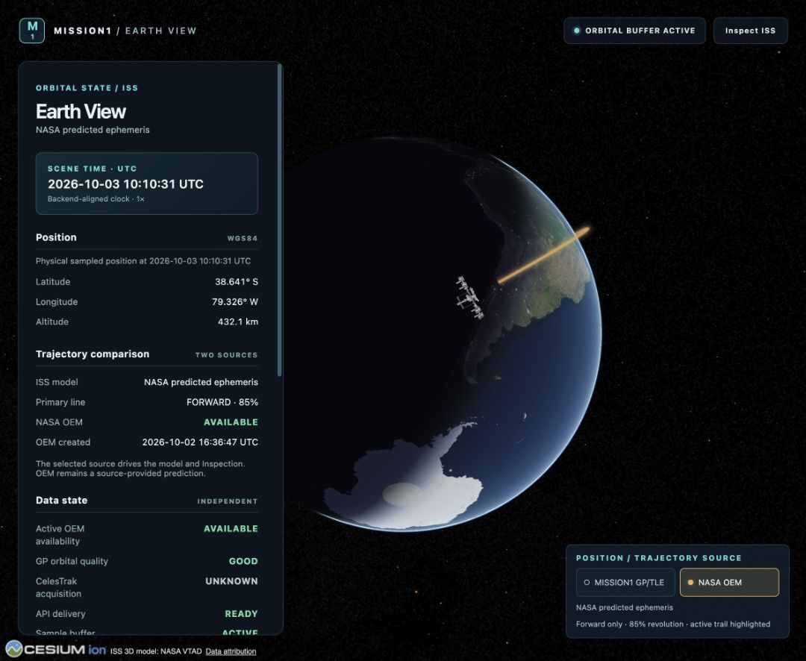
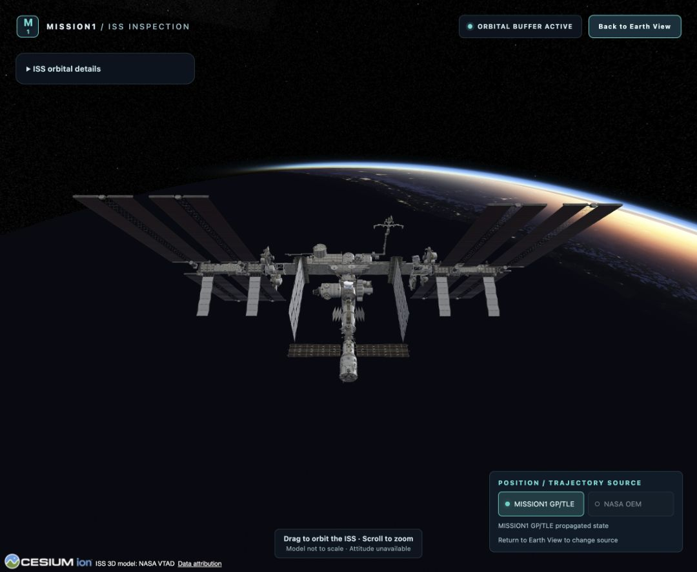
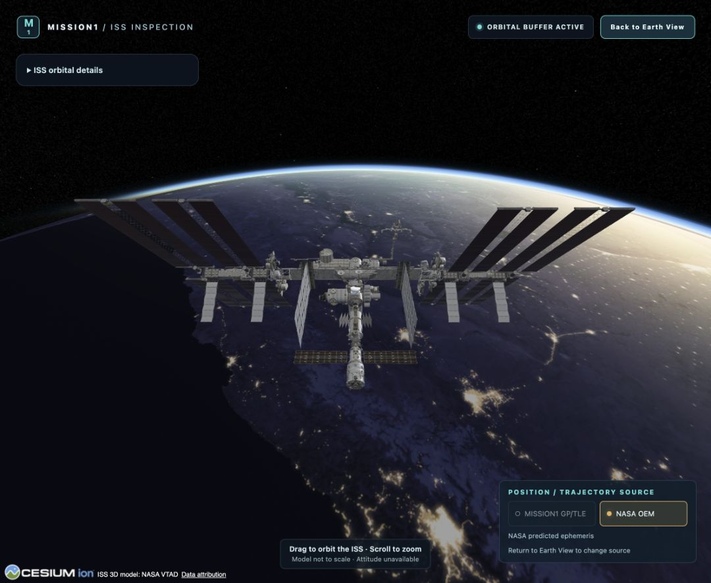
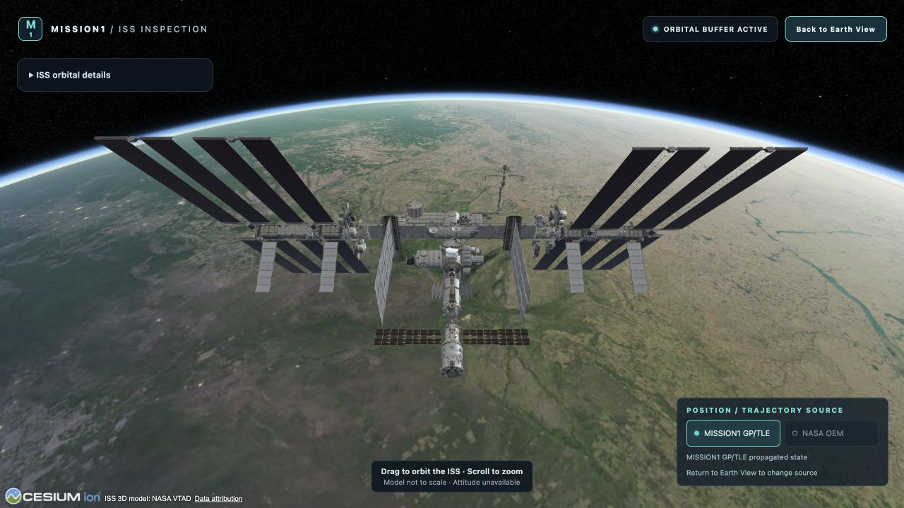

# Crew ingestion/persistence acceptance — 2026-10-03

**Current scheduling extension (2026-10-03):** [ISS Crew event-aware refresh](../event-aware-refresh.md) adds a bounded LL2 docking/undocking calendar, conservative NASA anticipation and durable completed-NASA-transfer follow-up. Planning events remain separate from crew presence and assignment truth. Baseline 2h source schedules, parser/reconciliation semantics and this document’s dated validation evidence remain applicable. New operational history uses V5; see the [new validation dossier](../event-aware-refresh-validation/README.md). Next single milestone: **ISS CREW REPLAY INTEGRATION**, not started.

The implemented milestone is **ISS CREW INGESTION + POSTGRESQL PERSISTENCE**. The accepted starting repository was `/Users/daniel/Desktop/MISSION1`, clean `main == origin/main == 1f46df25709400932e0640669b3277c565c6bd48`, fetched from `git@github.com:therabo/MISSION1.git` before modification. The durable decision and short design note were written before migration/code implementation. No history rewrite is used.

## Context reviewed

- `/Users/daniel/Documents/ChatGPT/MISSION1/AGENTS.md` and external `/Users/daniel/Desktop/mission1-project.md`.
- Actual project skill files: mission-data-pipeline, iss-ground-segment-architecture, telemetry-quality-and-provenance, devops-local-platform, architecture-decisions, iss-public-data-sources; realtime-api-contracts consulted only for future compatibility; flight-dynamics-orekit only for the frozen boundary. Software-architect and its ADR guide were read. Pipeline contracts, architecture/component review, provenance/quality, local-runtime/CI, source-verification, API conventions and ADR template references were consulted.
- Crew README, source-validation README, domain contract, authority/reconciliation, validation/regression; architecture 03/05; Crew API draft; ADR index and ADRs 0001/0002/0007; backend README.
- Every existing Crew domain type and all four ports, LL2 DTO/mapper/source/HTTP reader and NASA document adapter; existing JDBC adapters, Flyway V1/V2, PostgreSQL Testcontainers test patterns, scheduling/source-refresh service, configuration and injected UTC Clock.

## Architecture and schema

[Authoritative persistence document](../persistence-and-ingestion.md) contains the complete table/PK/FK/unique/index matrix and configuration. Nine actual tables were added: crew_source_sync_run, crew_source_snapshot, crew_person, crew_person_external_id, crew_expedition, crew_expedition_external_id, crew_person_observation, crew_expedition_observation and crew_assignment_observation. Agency, nationality lists and media rights are bounded typed JSONB fields within person observations, not separate global master-data tables.

A sync run represents an invocation/fetch outcome. A snapshot represents a unique immutable source state. UUID anchors mean stable identity, with exact source external-ID mappings; names never merge people. Observations contain source-varying fields and relationships. Person and expedition mappings have database uniqueness `(source,external_id)` and composite consistency FKs; original fields and mappings cannot be rewritten by the application. Snapshot uniqueness includes source/station/source station ID/API version/adapter version/hash. There is no opaque full-domain JSONB blob or raw LL2 payload archive.

Flyway migration: **V3**, `V3__crew_source_observation_history.sql`. Real PostgreSQL 16.10 Testcontainers applied V1/V2/V3 to an empty database, then separately applied V3 to a V2 schema containing a test sentinel in the original OEM table; sentinel bytes/time remained unchanged and Flyway validate passed. Real local application startup upgraded its existing V2 schema to V3 automatically. Existing orbital migrations and tables were not modified.

## Deterministic evidence

`JdbcCrewRepositoryTest` executes **24 PostgreSQL tests** (including parameterized source outcomes):

| Behavior | Actual evidence |
| --- | --- |
| Identical successful source bytes | Two service ingestions: two runs, one snapshot, seven person/assignment observations, one expedition observation; internal IDs reused; latest retrieval advances independently of first observation. |
| Profile/role/roster change | Synthetic variation of the recorded fixture changes name/biography/in_space/duration/count/media and Commander→Flight Engineer, removes one person. New snapshot has six assignments; old snapshot retains seven and original values. Person/expedition UUIDs remain stable. |
| Different external ID, same name | Creates a different person UUID; total anchors becomes eight. No name matching. |
| Changed expedition external ID | New expedition UUID; prior expedition graph remains unchanged. |
| Nullable/multi-nationality/media/duration | Previous nullable fixture fields remain null/empty; added test nationality remains separate; agency/credit/license/link/single-use round-trip; fractional Duration retains nanoseconds. Absolute instants explicitly truncate to PostgreSQL microseconds. |
| Failure history | Timeout, 404, 429, 5xx, malformed, no-active and ambiguous outcomes complete runs without empty/new snapshots or loss of last good state. Source transport failures are additionally covered by existing loopback/mock tests. |
| Atomic rollback | Test triggers fail mid-assignment and mid-profile insertion. New graph and newly allocated anchors roll back. Started run survives and completes PERSISTENCE_FAILURE. A previous successful graph also remains byte-equivalent after failed update. |
| Latest state | A→B→A reuse→failure returns A via the last successful run, even though B is the newer snapshot; last successful fetch 14:00 and failure attempt 16:00 remain distinct. |
| Database safety | Duplicate hashes/mappings/assignments and history mutation are rejected; deletion through identity anchors cannot erase observations. |
| Concurrency | Two direct transactional writers deduplicate one graph/identity set; overlapping coordinator calls perform one source operation and record the other as SKIPPED_OVERLAP. |
| Durable eligibility | Restarted coordinator skips before Retry-After; later eligibility resumes once, without retries. A scheduled early skip does not postpone normal eligibility. |

The DB column `in_space` exists only in source profile observations. The schema contains zero canonical/current presence tables or currently-aboard fields. LL2 membership and in_space never instantiate StationPresence.

`CrewIngestionService`, `CrewSnapshotValidator`, `CrewRepository`/`JdbcCrewRepository`, `CrewQueryService`, `CrewIngestionPolicy`, `CrewIngestionConfiguration` and `CrewIngestionScheduler` are the actual components. The existing StructuredCrewSource/LaunchLibrary2CrewSource owns source acquisition/normalization. Queries remain internal, source-aware and provenance-bearing.

Transaction sequence: committed IN_PROGRESS run → HTTP outside a DB transaction → atomic identity/graph/success commit. Graph failure rolls back, then failure completion commits separately. Source outcomes touch only runs. If PostgreSQL itself is unavailable, initial run creation prevents HTTP or later failure completion may leave IN_PROGRESS; scheduler logs the issue and remains callable. No promise of failure-record durability is made during a DB outage.

## Scheduler, rate limiting and request budget

Default enabled, **PT2H fixed delay**, **PT5M initial delay**; minimum PT1H/PT1M. Environment overrides are in the persistence/backend docs. Test profile disables Crew scheduling. Configuration tests inspect the actual registered FixedDelayTask using custom PT3H/PT7M values and verify zero repository work at registration; disabled mode retains service/query beans. Scheduler tests prove exceptions are contained and a subsequent invocation runs.

The default-enabled real backend started at **10:03:15.878 UTC**. At **10:06 UTC**, direct PostgreSQL inspection found **zero Crew runs**, before the configured five-minute delay. After this observation, Crew scheduling was temporarily disabled for the remaining browser QA to keep live acquisition bounded. Final runtime can use the committed default again without a source request on startup. The controlled validation database's opt-in process had both schedulers disabled.

429: store actual HTTP status, raw Retry-After and parsed eligibility. Support delay-seconds and HTTP-date. Before eligibility, persist SKIPPED_RATE_LIMIT and make zero HTTP calls, also after coordinator restart. Missing/malformed header uses the normal interval as local fallback policy. Normal per-run automatic retry count is **zero**; timeout/5xx/network failures wait for the next eligible scheduled attempt. One process-local atomic guard prevents overlapping manual/scheduled source and persistence work. Multi-instance scheduler coordination is deferred; the PostgreSQL advisory transaction lock only protects identity allocation.

A normal refresh performs **one active detailed expedition GET**, no pagination, station lookup or per-astronaut detail calls. SQL anchor lookup is one batch query per entity type; graph writes use JDBC batches per collection. No query per source field or obvious N+1 read loop was introduced. Exact SQL-statement totals were not instrumented. The scheduled job uses the existing Spring scheduler and has no continuous frontend/orbit computation; a synchronous tick can occupy it for bounded HTTP/database work. No new graphics/FPS guarantee is claimed.

## One bounded live ingestion

Actual authorized opt-in service ingestion, with PostgreSQL and both schedulers disabled:

| Field | Observed value |
| --- | --- |
| Validation UTC | `2026-10-03T10:03:14.622725Z` |
| Retrieval UTC | `2026-10-03T10:03:14.437689Z` |
| Source URL | `https://ll.thespacedevs.com/2.3.0/expeditions/?space_station=4&is_active=true&mode=detailed&ordering=-start&limit=10` |
| HTTP / source result | 200 / AVAILABLE |
| Content SHA-256 | `7d391ce4dd63dbc5dbf94cafa8cd82b96be50da74dc82ff4ddd11932f3573f91` |
| LL2 station external ID | `4` |
| Source expedition | `Expedition 75`, external ID `168` |
| Source assignment count | 7 |
| Sync-run / snapshot ID | 1 / 1 |
| Snapshot insertion | New; duplicate handling verified offline without a second live request |
| Internal expedition UUID | `c5364b90-1dd9-4673-9a13-4479c68d247c` |
| Representative elapsed ingestion | 1201.375 ms, including network and storage; local observation, not a guarantee |

[Full dated normalized run/snapshot report with person UUIDs](live-ingestion.json) contains source observations, not canonical ISS presence. Duration JSON numbers in this report use the existing Jackson duration-seconds representation; PostgreSQL stores ISO-8601 duration text. No complete upstream HTTP payload or credentials are archived. This milestone made **one intentional live LL2 data request**, zero retries, zero astronaut enrichment and no additional NASA acquisition.

Direct `psql` inspection of controlled database `mission1_crew_validation_20261003` confirmed these dated counts:

| Table/metadata | Count |
| --- | --- |
| Sync runs / snapshots | 1 / 1 |
| Person anchors / person external mappings | 7 / 7 |
| Expedition anchors / external mappings | 1 / 1 |
| Person observations / expedition observations / assignments | 7 / 1 / 7 |
| Nationality entries / agency objects / media assets | 7 / 7 / 7 |
| Profile source in_space=true | 7; no canonical presence records |

Counts describe this controlled capture, not product invariants. No second live request was needed to prove idempotency.

## Frozen regression and automated gates

[Byte audit](frozen-baseline-audit.json) compared all **92 pre-existing frontend files**, **48 orbital runtime/data/configuration files** and **2 original migrations** to the accepted baseline: zero changes. The only edited orbital test line updates the expected total Flyway migration count from two to three; production orbital code/configuration and V1/V2 are untouched.

CelesTrak/TLE acquisition, GP propagation/Orekit/EOP, NASA OEM, orbital persistence/REST/source switching, Cesium/trajectories/camera/Inspection/model/textures/Earth imagery/silhouette/frontend graphics remain unchanged. Existing tests and [HTTP smoke](orbital-api-smoke.json) returned 200 from state/samples/comparison at 10:06:09 UTC. Browser QA uses real backend responses without interception, synthetic runtime source data, clock overrides or scene hooks.

| Gate | Result |
| --- | --- |
| Java 21 `mvn -o test` | **156 tests**, 0 failures/errors/skips: 120 baseline + 36 new |
| Java 21 `mvn -o verify` | **156 tests**, 0 failures/errors/skips; packaged application succeeds |
| Crew PostgreSQL Testcontainers | **24 tests**, real PostgreSQL 16.10, clean/upgrade/constraints/dedupe/history/rollback/latest/concurrency |
| Scheduling/policy tests | 12 new configuration/policy tests; no public network |
| Frontend tests | **171 tests / 26 files**, all passed |
| Frontend typecheck / production build | Passed; pre-existing large-chunk warning retained |
| Local PostgreSQL / backend startup | PostgreSQL 16.10 healthy; V2→V3 succeeded; backend serves port 8080 |
| Orbital API smoke | State/samples/comparison HTTP 200 |
| Production Earth View smoke | GP/OEM selection, model/trajectories, both Inspection/Back cycles; console 0 errors/warnings |
| Development Earth View smoke | GP Inspection/Back and Earth View against the same backend; console 0 errors/warnings; evidence below |
| Diff/secret/scope audit | Final diff reviewed; git diff --check passes; no credentials introduced |

NASA document/evidence contracts remain intact. No automatic semantic NASA parser or NASA scheduler, Crew canonical reconciliation, REST controller, Crew frontend, notifications, docking-triggered refresh or Replay UI was added. Orbital RTN separation analysis remains pending.

## Documentation and ADR

Changed: Crew README, domain contract, authority/reconciliation, validation/regression pointer, new persistence-and-ingestion document and this evidence dossier; architecture 03/05, backend README, API draft provenance wording (still DRAFT/NOT IMPLEMENTED), ADR index and **ADR-0008: Persist Crew as immutable source observations with stable identity anchors**. The durable identity/history/replay/reconciliation trade-off meets the existing ADR threshold; existing ADRs were not silently rewritten.

External `/Users/daniel/Desktop/mission1-project.md` is updated separately with architecture, scheduler/history policy, completed milestone and next gate; it remains outside Git. Git acceptance/synchronization is reported after the ordinary commit and SSH push in the final response/external context, avoiding a commit hash self-reference in this dossier.

## Browser evidence

Next single milestone: **NASA CREW VERIFICATION + RECONCILIATION**. It has not been started.
