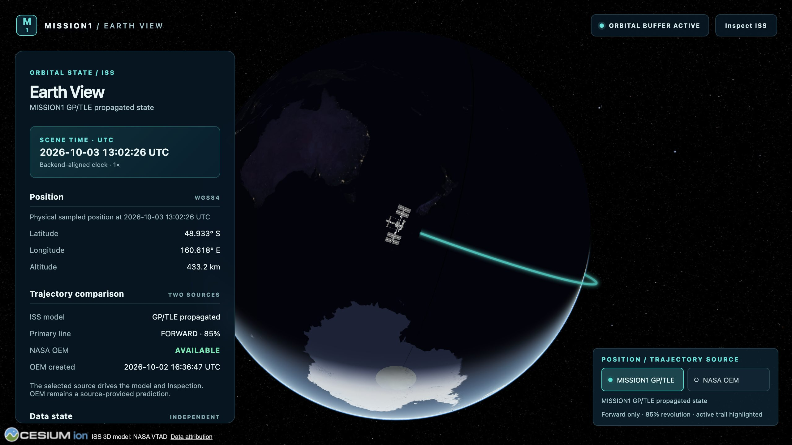
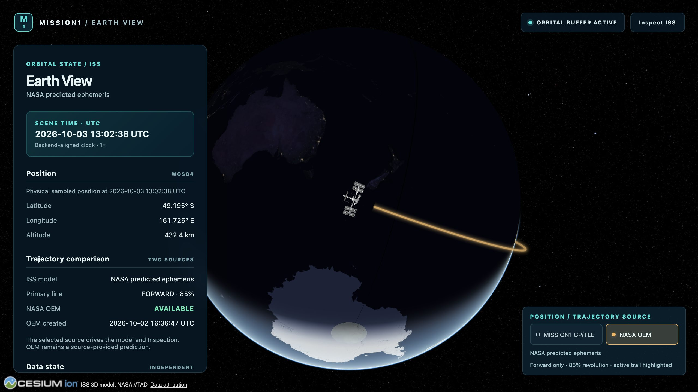
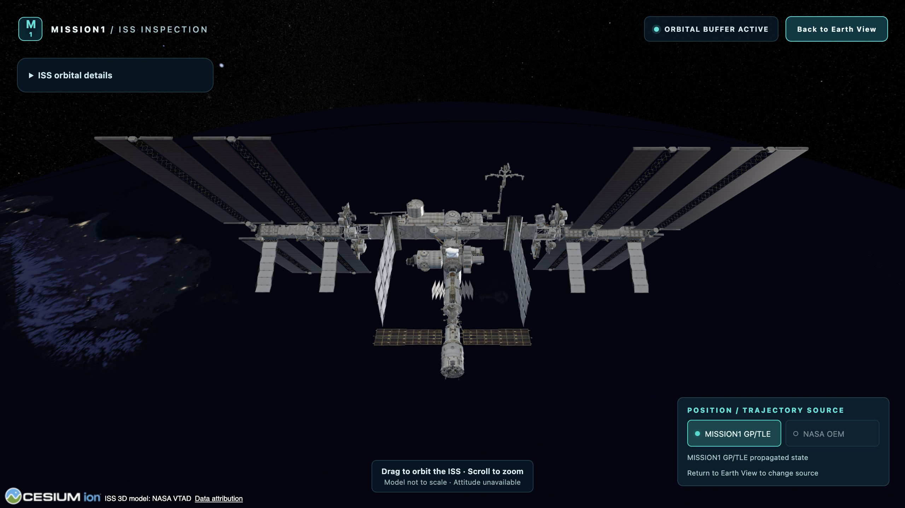
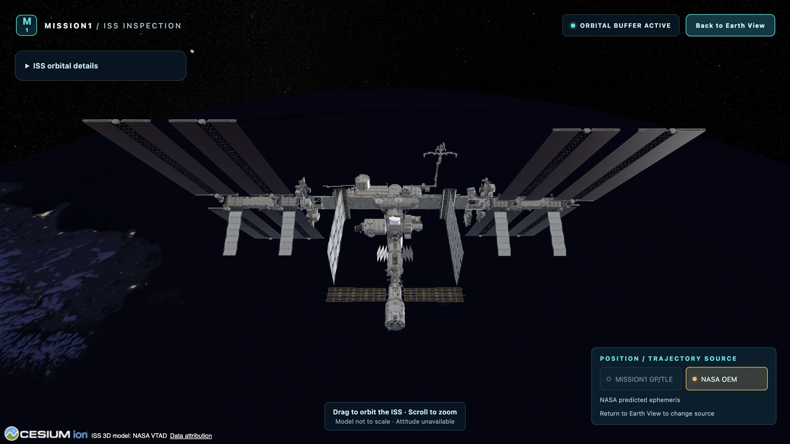

# ISS Crew REST API — validation dossier

Validated **2026-10-03** from clean synchronized baseline `46c09d635454fb48ffd6ceec7f237bec9eb90c9f`, repository `/Users/daniel/Desktop/MISSION1`. Initial fetch confirmed local main == origin/main; accepted history is retained. Ordinary commit/push follows these gates, with final hash/synchronization reported in the chat and external project context. This milestone implements Crew REST only. Next: **ISS CREW EARTH VIEW PANEL**; not started.

## Context reviewed

Project AGENTS `/Users/daniel/Documents/ChatGPT/MISSION1/AGENTS.md`; external `/Users/daniel/Desktop/mission1-project.md` including current accepted baseline and source/ingestion/reconciliation sections; project skills directory. Applied actual skills realtime-api-contracts, iss-ground-segment-architecture, telemetry-quality-and-provenance, software-architect, devops-local-platform, mission-data-pipeline, iss-public-data-sources (existing verified provenance only), architecture-decisions; flight-dynamics-orekit consulted only for frozen boundaries. API conventions, architecture principles, quality/provenance, local-runtime/CI and ADR guide references were read. No frontend implementation skill or subagent was needed.

Read Crew README, source-validation README, domain-contract, source-authority-and-reconciliation, persistence-and-ingestion, nasa-verification-and-reconciliation, validation-and-regression, ingestion-validation README, reconciliation-validation README; old Crew API draft; architecture03/05; ADR0007/0008/0009 and index; backend README. Inspected existing orbital controllers/response/error ProblemDetail conventions, CrewQueryService/CrewReconciliationQueryService/read models, underlying repositories/JDBC/schema, source health, profile/UUID resolution projections, reconciliation engine/policy and PostgreSQL/MockMvc test conventions. No new external provider field/endpoint/asset or live Crew source acquisition was introduced; accepted same-day verified source evidence supplies naming and provenance.

## Contract and read architecture

[Implemented contract](../../api/crew-api.md) was recorded before code. [Old draft](../../api/crew-api-draft.md) is explicitly SUPERSEDED.

```text
PostgreSQL
  → CrewQueryService / CrewReconciliationQueryService + CrewReadQueryService
  → CrewRestQueryService (read-only REPEATABLE_READ composition)
  → CrewController
  → CrewResponses public DTO JSON
```

Exactly three GET routes: `/api/iss/crew`, `/api/iss/expedition/current`, `/api/iss/crew/{astronautId}`. Thin controller does paths, canonical UUID parsing and serialization; no SQL, matching or reconciliation policy. CrewReadRepository/JdbcCrewReadRepository adds read projections only. No migrations or existing writer/source/parser/reconciler/scheduler code changes. No authentication/CORS changes, new dependency, service or distributed infrastructure. No caching/ETag; success responses use no-store because effective freshness changes without new source bytes.

The API uses MISSION1 UUIDs, labeled external identifiers, explicit optional nulls, arrays, ISO Instant and Duration strings, public enum names and source URLs. No internal database PKs, raw RSS/HTML/XML, source bodies, SQL, excerpts, matching keys, candidate-resolution internals or parser diagnostics are public. Biography is source text, not trusted HTML. Profile rights include URL, thumbnail, credit, licenseName/licenseUrl and nullable singleUse; no media download/mirroring occurs.

## Dated real response

At **2026-10-03T12:59:23.633016Z**, read from the existing real PostgreSQL database with source schedulers temporarily disabled:

| Quantity | Observed value |
| --- | --- |
| Structured assignments | 7 |
| Official current aboard count | 11 |
| Resolved currently confirmed aboard | 8 |
| Unresolved NASA assertion-subject entries | 3 |
| Reconciler unidentified count gap | 3 |
| Resolved member union | 9 |
| Reconciliation | PARTIAL_MATCH |

These are dated observations, not permanent production/test invariants. Official count is not member-array length or assignment count. Six shared identities, one LL2-only UNVERIFIED assignment, two NASA-only confirmed people without assignments/profiles, and three unresolved names remain distinguishable. The response adds no fabricated identity, biography or agency. Unresolved entries expose the existing evidence type/time/source/applicability and resolution status; the domain does not produce a canonical unresolved-person presence state. They are assertion-subject entries, not deduplicated verified people. A count gap can include unknown names and must never manufacture placeholders.

Examples: [Crew JSON](crew-response.json), [Expedition JSON](expedition-response.json), [person JSON](person-response.json), [404](unknown-person-response.json), [400](malformed-person-response.json). Current authoritative count becomes null when its unchanged applicability/verification policy fails; the retained reconciler count stays separately visible when available. Per-member states/status/freshness are preserved; no API write changes domain history.

Expedition exposes current structured outcomes: a successful graph remains readable after failed refresh; explicit NO_ACTIVE_EXPEDITION returns 200/null expedition/zero assignments and survives a later transport failure until another valid semantic state. Crew retains the exact LL2 interpretation input independently. Person resource exists independently of current roster membership: latest known successful profile follows fetch-run order, including A→B→A reuse; NASA-only detail stays valid with nullable profile fields.

## HTTP/error matrix

| Scenario | Status | Content type / semantics |
| --- | --- | --- |
| Crew / current Expedition / known person | 200 | application/json, Cache-Control no-store |
| Usable partial/degraded/stale state | 200 | Existing status and independent source health |
| Explicit NO_ACTIVE_EXPEDITION | 200 | null expedition, assignmentCount0, assignments[] |
| No usable Crew state | 503 | application/problem+json, crew-state-unavailable |
| No usable structured outcome ever | 503 | crew-primary-unavailable |
| Unknown canonical UUID | 404 | person-not-found |
| Malformed/noncanonical UUID/LL2 integer | 400 | bad-request |
| Internal read/mapping/database failure | 500 | sanitized crew-internal-error |

ProblemDetail types are `urn:mission1:problem:<code>`, with standard title/status/detail/instance. Error text never reflects SQL/exception internals. [Runtime status/content-type record](runtime-smoke.json); no-data/internal-error cases are deterministic controller/PostgreSQL tests, not fabricated production incidents.

## Zero-network and zero-write evidence

Real PostgreSQL `CrewPostgresApiTest` calls all three mapped/serialized endpoints, with LL2 fixture and configured adapter/source-ingestion guards plus NASA HTTP fixture counter. GET asserts **LL2 calls0, NASA calls0, database writes0, reconciliation writes0**. All21 Crew table counts match before/after; SQL instrumentation sees only SELECT and read-only connections at TRANSACTION_REPEATABLE_READ. Architecture tests reject source/HTTP/JDBC/writer dependencies in api/crew and domain/persistence types in public DTO records.

[Real runtime record](runtime-smoke.json) independently hashes every Crew table's complete rows as well as counts before/after API smoke and 180 warmup/measured reads: all tables are identical, including source attempts, evidence, identities and reconciliation operations. Runtime uses temporary disabled-source configuration; committed defaults are unchanged. No source refresh is triggered by GET. Instrumented source-call totals come from deterministic tests; runtime row/hash stability is a separate observation, not a packet capture.

## SQL and performance

On the paired persisted fixture, actual prepared SQL counts: **Crew39, Expedition11, Person39**. Existing canonical query reads source health/evidence/interpretation in batches and repeats some bounded input reads. Added identity/profile/mapping projection is four set-based reads; no per-member SQL. The structured-only growth test gives **31 reads for7 members and31 for37 members**. This proves no N+1 roster pattern; retained assertion/history processing and result size still grow with history. A projection/index/retention optimization is future work only if measured need develops.

| Endpoint | Measured samples | Median ms | p95 ms | Worst ms |
| --- | --- | --- | --- | --- |
| Crew | 50 + 10 warmup | 44.756 | 99.143 | 129.128 |
| Expedition | 50 + 10 warmup | 11.200 | 23.978 | 32.247 |
| Person | 50 + 10 warmup | 31.514 | 45.899 | 53.764 |

Local loopback HTTP end-to-end timings include PostgreSQL/serialization/client overhead, with browser QA starting concurrently. Ten warmups precede fifty samples per endpoint; p95 uses nearest-rank sample48/50. These are comfortably interactive local observations, not service guarantees. [Raw timings](runtime-smoke.json). Caching was reviewed and deferred; no incorrect snapshot-only ETag.

## Tests and regression

| Gate | Result |
| --- | --- |
| Java21 Maven offline test | 268 tests, 0 failure/error/skip |
| Java21 Maven offline verify | 268 tests, package/repackage succeeds |
| Crew PostgreSQL16.10 Testcontainers | 53:42 retained +11 new HTTP/read tests |
| REST controller/JSON + PostgreSQL HTTP | 40:29 controller +11 full-chain |
| REST architecture gates | 3 |
| Frontend tests | 171 /26 files, unchanged |
| Frontend typecheck / production build | PASS; existing large-chunk warning |
| Backend startup | Packaged jar, PostgreSQL16.10, Flyway4/up-to-date |
| Real Crew HTTP smoke | Three200, unknown404, malformed400 |
| Orbital API smoke | state/samples/comparison200 |
| Browser regression | Dev5175/prod4175, GP/OEM model/trajectory + Inspection/Back; recorded below |
| Frozen byte audit | 256 existing files unchanged, including92 frontend and162 backend source/test/data files |
| git diff --check / complete scope review | PASS; all new code/evidence and changed docs reviewed; no unrelated source files or secrets |

[Machine-readable test gates](test-gates.json), [frozen audit](frozen-baseline-audit.json). All eight reconciliation status strings pass JSON mapping tests; retained pure-engine tests validate actual status derivation. Full exhaustive MATCH, the11/8/3/7 partial class, LL2-only unverified, NASA-only, nullable/multiple-nationality/complete profile, historical membership, profile snapshot reuse, ISO durations including fractional values, Unicode, JSON biography text/media rights, unknown/malformed UUID, stale current count versus retained count, rate limits, source failure, no-state/no-active and sanitization are exercised. Runtime-dependent real names/counts appear only in dated evidence/recorded test-only fixtures, never application constants.

After source-isolated validation, the final packaged backend was restarted with the normal enabled scheduler defaults and no overrides (PID87271, port8080). [Final startup smoke](final-startup-smoke.json) at 2026-10-03T13:18:58Z confirms all three Crew and all three orbital routes return200, Flyway4 is up-to-date and Crew tables stay unchanged. This smoke finished before the initial source-scheduler delays. PostgreSQL and development/production preview remain running.

CelesTrak, TLE/GP, Orekit, OEM, orbital persistence/API/switching, source parsers, Crew ingestion/reconciliation/freshness policy, schedulers, camera/focus/trajectory/Inspection/model/Cesium/frontend source/assets remain unchanged. Browser QA has no interception, clock override or injected scene state. GP remains computed from elements (locally stale); OEM remains source-provided prediction; actual station attitude stays unavailable. This is a focused unchanged-system smoke, not a new camera/graphics benchmark.

## Browser evidence and reproduction

[Browser record](browser-smoke.json) verifies four GP/OEM dev/prod cycles, model-ready/trajectory-loaded state, Inspection and Back, zero console warning/error, page errors or failed requests, and served bundle byte-equivalent to the build. Screenshots were visually inspected. The initial smoke captured GP while the comparison was still loading; the final evidence explicitly waits for both trajectory products before capture, with no frontend change.






Use existing Java21/Docker/Node24 setup. `mvn -o test` and `mvn -o verify` run offline against fixtures/mock HTTP/Testcontainers. Start PostgreSQL with `docker compose up -d --wait postgres`; start the packaged backend with temporary MISSION1_CREW_INGESTION_ENABLED=false, MISSION1_CREW_VERIFICATION_ENABLED=false, MISSION1_CELESTRAK_REFRESH_ENABLED=false. `python3 docs/crew/rest-api-validation/scripts/validate-runtime.py` exports real persisted responses, hashes and latency; it makes no Crew source call or write. Existing dev/preview servers are required for `node docs/crew/rest-api-validation/scripts/browser-smoke.cjs`; the script uses the installed bundled Playwright runtime and browser, normal real backend/source rendering and no scene instrumentation. HTTP comparison retains its existing independent OEM behavior; Crew read-side-effect evidence is captured before those orbital reads.

## Documentation and ADR review

Created implemented API contract, this dossier, response/status/runtime/test/freeze/browser evidence and two bounded reproduction scripts. Updated old API draft to SUPERSEDED; Crew README/domain contract/source-authority/persistence/NASA design/validation-regression; architecture03/05 and backend README. Original `/Users/daniel/Desktop/mission1-project.md` is updated externally and remains outside Git.

No new ADR: ADR0007 already governs field authority/public UUIDs,0008 immutable source history,0009 effective temporal reconciliation/provenance. Existing REST/JDBC conventions and the same module/process/database boundaries are extended; no new durable technology or source/domain decision is introduced.
