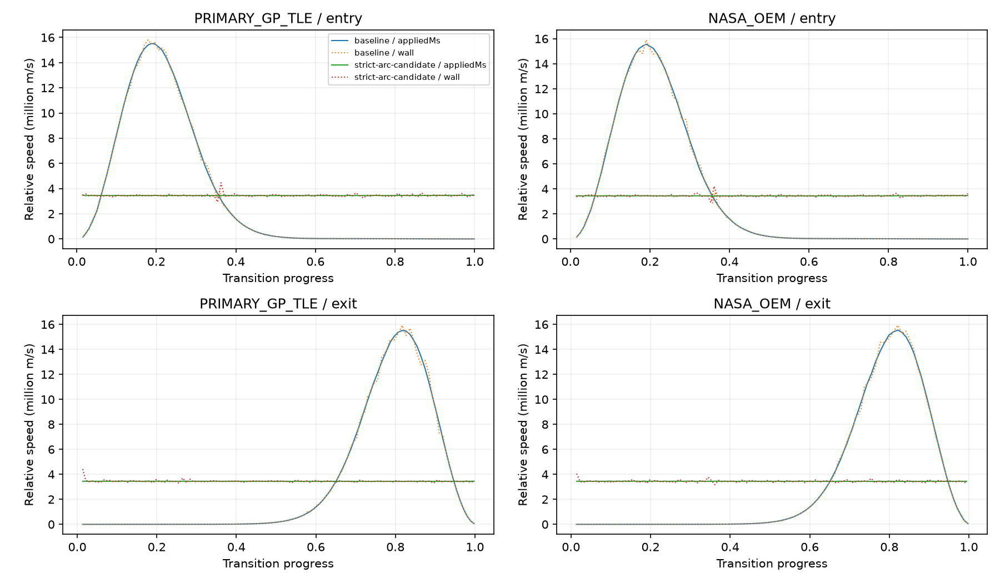

# Camera transition review — 2026-10-01

The strict constant-metres-per-second candidate was inspected and reproduced before it was evolved. The user explicitly replaced that criterion with gradual perceptual progression. Its useful cubic geometry, display-target correction, exact endpoints and historical evidence remain.

The [current perceptual review](perceptual/README.md) records the implementation, actual raster growth, frame traces, reversal derivatives, browser matrices and separate performance comparison. The original [strict-speed rejection](strict-speed-review.md) remains preserved verbatim; its pending-priority and no-commit statements describe that historical candidate.

# Historical strict-speed review — 2026-10-01

**Not accepted. No commit or push.** The starting repository was clean and synchronized at `538bb0642205be7f326aa3ae08ec2dc46134a212` on local `main`, `origin/main` and GitHub `main`. This review records an uncommitted strict physical-speed candidate. Endpoint math and exit targeting pass the measured checks; gradual apparent station growth does not. The current 5 s duration remains a comparison policy, rather than a newly accepted duration/speed policy.

## Acceptance decision still required

A ~17.23 million metre route traversed in 5 s requires ~3.45 million m/s. At that speed the last kilometre takes ~0.29 ms, much less than one rendered frame on this host. For a physically scaled station, apparent size is approximately proportional to `1 / (range × tan(FOV/2))`. Holding the accepted 90 m endpoint, 100° desktop FOV and minimumPixelSize 80 means the final close-up cannot become gradual during a few-second constant physical-speed route. FOV progression from 60° to 100° does not remove this range dependence. A constant 100 m/s traversal would require about 47.9 hours. Enlarging the station or inventing an orbital path would change accepted presentation or source semantics and is outside this candidate.

The requested priority clarification is pending: permit nonconstant m/s for uniform perceived motion and gradual framing, or retain strict constant m/s and accept the rapid apparent-scale change. Neither alternative is silently treated as authorized. The milestone is not complete and the conditional commit/push steps have not run.

## Context actually reviewed

- `/Users/daniel/Documents/ChatGPT/MISSION1/AGENTS.md`.
- External `/Users/daniel/Desktop/mission1-project.md`; unchanged by this work and outside Git.
- Actual skill files: `iss-3d-earth-view`, `iss-3d-station-view`, `frontend-design-codex`, `devops-local-platform`, `iss-ground-segment-architecture`, `telemetry-quality-and-provenance`, `flight-dynamics-orekit`, `architecture-decisions`. Relevant Earth data/scene, station mapping/coordinate and local runtime/CI references were read. No dedicated rendering/performance skill was present.
- Frontend and backend READMEs; `iss-model.md`, `iss-inspection-mode.md`, `rendering-quality.md`, `orbital-trajectory-rendering.md`; orientation, rendering-optimization and trajectory-presentation review READMEs.
- Architecture `03-repository-and-roadmap.md`, `04-earth-view-orbital-delivery.md`; ADRs `0005-separate-nasa-oem-comparison-trajectory.md`, `0006-selectable-forward-trajectory-visualization.md`, ADR index.
- The transition state machine, camera controller profiles, selected-source sampled position and physical velocity, F/L/U construction, model centering/lift/silhouette, pose capture, quaternion conversion, FOV and frame handoffs were traced before replacement. Public APIs were checked against [Cesium Camera](https://cesium.com/learn/cesiumjs/ref-doc/Camera.html) and [SceneTransforms](https://cesium.com/learn/cesiumjs/ref-doc/SceneTransforms.html).

No structural architecture change is proposed, and accepted ADRs remain unchanged pending visual acceptance. No orbital adapter, backend, asset, texture, material, trail policy or source contract is changed.

## Proven entry acceleration cause

The baseline interpolates local unit direction on a sphere and range logarithmically, with both driven by `w(p)=p³(10−15p+6p²)`. Even replacing `w` with linear `p` would not give constant physical speed. For a stationary frame, `r=r0 exp(k w)` and angular travel `θ w` give speed `r |dw/dt| sqrt(k²+θ²)`, where `k=log(r1/r0)`. The exponential range multiplier and nonuniform easing derivative produce the large early surge and long final braking. Current-frame rotation and world-endpoint blends add smaller time-dependent terms.

Baseline relative-speed CV is 162.1% / 162.7% on GP/OEM entry, and 165.6% / 167.7% on exit using pose application times. GP entry spans 24.1 to 15,517,686 m/s; the median is only 101,316 m/s. These are measured distances divided by elapsed times, not raw inter-frame distances. Baseline orientation separately SLERPs the captured Overview pose toward the current physical station pose while the camera position changes; this loses target composition during mid-entry as well.

## Exact exit framing failure

All compared baseline exit frames use the world identity transform. There is no threshold reference-frame switch causing the failure. The displayed model lifts independently while the camera aims predominantly at the physical pivot.

| Source | Previous good | First bad | First recovery | Bad exit frames |
|---|---|---|---|---:|
| GP/TLE | frame 6, 3.878%, display (640.159, 99.933) | frame 7, 4.924%, display (640.761, −578.619) | frame 77, 52.926%, display (802.588, 62.424) | 70 |
| OEM | frame 6, 3.784%, display (640.140, 125.163) | frame 7, 4.746%, display (640.560, −366.192) | frame 77, 53.122%, display (794.640, 86.687) | 70 |

At GP frame 7, camera range is 91.216 m and lift is 83.057 m; physical ISS projects to (640.152, 360.104), but the displayed station projects above the viewport. World camera is `(−2719722.335398, −6173897.645624, −885033.347475)` m, direction `(0.632336310, 0.369251903, 0.681031441)`, FOV 99.956°. At OEM frame 7, range is 91.092 m and lift 74.577 m. Raw JSON and CSV retain complete direction/up/right, transform, targets, range, UTC, controller and presentation state for the previous, bad and recovered frames.

Baseline entry also loses the station: GP frame 62 at 51.186%, OEM frame 62 at 51.484%; 8 and 7 off-screen frames respectively. The pose-reconstruction images reproduce recorded geometry and UTC; their UI and trail rendering remain Overview and they are explicitly **reconstructions**, not original transition screenshots. Frames 6/7/8 and 76/77 bracket the exact exit failure/recovery.

[Previous good GP pose](baseline-PRIMARY_GP_TLE-exit-reconstruction-6.jpg) · [First bad GP pose](baseline-PRIMARY_GP_TLE-exit-reconstruction-7.jpg) · [Recovery](baseline-PRIMARY_GP_TLE-exit-reconstruction-77.jpg)

## Candidate spatial and orientation model

The visible route is one cubic Bézier in the initial selected-source Forward/Left/Up frame. `P0` is the actual captured camera offset; `P3` is canonical Inspection offset on entry, or the captured Overview world position expressed in that initial frame on exit. Let `L=|P3−P0|` and `σ=−1` for entry, `+1` for exit. Controls are `P1=P0+σ normalize(P0)L/3`, `P2=P3−σ normalize(P3)L/3`; this aligns the near-station tangent with the final rear/elevated offset. An unsafe route uses the existing smooth Earth-centred angular/radial curve, with a radial bulge and corrected close-end tangent. Routes are preflighted at construction.

`ArcLengthPath` samples 8192 segments once into a cumulative Float64Array. Linear normalized distance selects a target cumulative length; binary search finds the adjacent entries, then linear interpolation in that interval finds the geometric parameter. Exact endpoints and zero-length routes are supported. No lookup is rebuilt per frame. Tests cover straight/curved 1 mm, 1 m and 17 Mm paths in both directions, monotonic tables, inverse clamps, finite geometry and zero division.

Every tick applies that retained local curve through the current selected-source physical F/L/U frame. Entry anchoring correction fades from the exact original world start; exit correction converges to the exact captured world endpoint. Neither source gets a fixed future target or a browser propagation model. Moving-frame corrections introduce the small residual speed variation measured below.

Orientation continuously recomputes aim using the same displayed model centre that the presentation code renders, while the physical pivot remains untouched. Residual quaternion SLERP connects actual initial framing and exact captured Earth framing to that moving aim. Preferred up changes with arc progress. The camera target remains separate from orbital data, display lift and actual attitude. FOV endpoints remain 60° Overview / 100° Inspection for the comparison camera; FOV interpolation changes from quintic to linear arc progress. The 75 km display-only lift and subtle white silhouette retain their existing presentation curves and interruption corrections.

Position/direction/up/FOV are captured at Back, including partial entry and OEM fallback. Captured Overview transform, near/far and existing controller profile are restored only at exit completion. Inputs remain locked through automatic motion. Position/direction/up match at state assignment, but a large finite last-frame size change remains visible; that distinction prevents a false “no snap” verdict.

## Measurement protocol

Same host, Chromium via ANGLE Metal, 1280×720 CSS viewport, DPR 2 (2560×1440 canvas), initial UTC `2026-09-30T15:45:59.975908Z` and identical world camera pose. Real historical backend fixtures are intercepted only in disposable QA builds; they are not runtime fallbacks. GIBS is made unavailable consistently for the same local imagery. The fixture clock advances at 1× during traces. Only one profiling browser runs at a time; backend builds/tests are finished before profiling. Baseline is a Git archive of the verified starting commit; the candidate is a disposable copy of the final working source.

Every rendered trace sample records pose, physical and displayed selected positions, relative offset, Earth range/height, current transform, FOV, lift/silhouette, controller flags, projected station/Earth/captured Earth target and conservative model hull. CSV camera quaternions are explicitly derived from each recorded direction/up basis, normalized and assigned consistent signs; they are not an additional orbital quantity or an independently measured spacecraft attitude. Angular differences use `atan2(|a×b|, a·b)`, avoiding small-angle acos rounding. Full raw frames include boundaries. Interior speed statistics include every adjacent pair with both samples in the transition state; idle samples and the clamped completion boundary are reported separately, rather than treated as constant-speed samples. No interior outliers are dropped.

Two time bases are explicitly reported. `appliedMs` is measured wall time near pose application, explaining the motion law. `wall` is actual postRender completion wall time, the requested rendered-frame metric. Variable render latency changes the second interval even when the pose progression is uniform. World-space speed is computed separately from relative-to-physical-ISS speed. Neither speed analysis is substituted for frame pacing.

### Relative speed at pose application

All speeds and standard deviations are m/s; duration is 5 s for each route.

| Route | Length (m) | Intended m/s | Mean | Median | Min | Max | SD | CV | p95 deviation | Worst deviation |
|---|---:|---:|---:|---:|---:|---:|---:|---:|---:|---:|
| GP/TLE entry | 17,227,411.587 | 3,445,482.317 | 3,446,891.361 | 3,445,190.384 | 3,430,153.606 | 3,482,487.552 | 8,956.118 | 0.260% | 0.464% | 1.074% |
| GP/TLE exit | 17,217,076.139 | 3,443,415.228 | 3,442,772.003 | 3,442,813.663 | 3,430,428.408 | 3,455,871.151 | 5,240.680 | 0.152% | 0.307% | 0.377% |
| OEM entry | 17,226,576.849 | 3,445,315.370 | 3,446,418.594 | 3,444,734.082 | 3,430,388.677 | 3,472,873.892 | 7,819.625 | 0.227% | 0.450% | 0.800% |
| OEM exit | 17,216,523.832 | 3,443,304.766 | 3,442,672.518 | 3,442,328.569 | 3,431,391.517 | 3,456,189.395 | 6,121.588 | 0.178% | 0.346% | 0.374% |

### Relative speed using actual render completion delta

All speeds and standard deviations are m/s; duration is 5 s for each route.

| Route | Length (m) | Intended m/s | Mean | Median | Min | Max | SD | CV | p95 deviation | Worst deviation |
|---|---:|---:|---:|---:|---:|---:|---:|---:|---:|---:|
| GP/TLE entry | 17,227,411.587 | 3,445,482.317 | 3,449,729.540 | 3,435,055.959 | 2,934,699.418 | 4,464,243.066 | 125,577.722 | 3.640% | 4.858% | 29.568% |
| GP/TLE exit | 17,217,076.139 | 3,443,415.228 | 3,451,557.989 | 3,446,425.326 | 3,284,919.158 | 4,422,831.591 | 107,183.307 | 3.105% | 3.677% | 28.443% |
| OEM entry | 17,226,576.849 | 3,445,315.370 | 3,449,419.716 | 3,442,791.959 | 2,909,717.052 | 4,208,506.052 | 107,587.070 | 3.119% | 4.010% | 22.152% |
| OEM exit | 17,216,523.832 | 3,443,304.766 | 3,443,999.124 | 3,436,746.163 | 3,174,899.825 | 4,051,889.044 | 97,703.994 | 2.837% | 4.066% | 17.674% |

### Worst render-time speed pairs

| Route | Frames / progress | Pose interval ms | Render interval ms | Render latency before → after ms |
|---|---|---:|---:|---|
| GP/TLE entry | [42, 43] / 0.35412→0.36278 | 43.300 | 33.400 | 17.500→7.600 |
| GP/TLE exit | [2, 3] / 0.00588→0.01374 | 39.300 | 30.600 | 15.000→6.300 |
| OEM entry | [43, 44] / 0.35332→0.36146 | 40.800 | 33.300 | 12.900→5.400 |
| OEM exit | [2, 3] / 0.00608→0.01434 | 41.300 | 35.100 | 10.600→4.400 |

The worst postRender spikes correspond to shortened completion intervals when render latency decreases; no spike is discarded. Remaining pose-time variation comes from selected-frame motion, world anchoring and timing around evaluation. This is a measured near-constant physical path, not perfectly constant displayed frame cadence.

### World-space speeds and angular continuity

| Route | Mean world m/s at pose time | Mean world m/s at render completion | Max direction speed °/s, render delta | Max direction step ° | Max up step ° |
|---|---:|---:|---:|---:|---:|
| GP/TLE entry | 3,447,015.289 | 3,449,852.290 | 35.848622 | 1.555830 | 1.131716 |
| GP/TLE exit | 3,442,624.888 | 3,451,397.017 | 27.878532 | 1.112353 | 0.927362 |
| OEM entry | 3,446,588.494 | 3,449,591.039 | 36.884353 | 1.523324 | 1.089020 |
| OEM exit | 3,442,418.510 | 3,443,740.852 | 26.672859 | 1.157602 | 0.863459 |

Angular maxima above include transition-to-completed-state pairs. Unit tests check orthonormal direction/up and equivalent quaternion continuity without a sign-flip discontinuity. Partial Back guarantees exact pose and FOV continuity at retarget; a C1 velocity guarantee across a reversal has **not** been established by those pose tests and must not be inferred from them.


Derived full camera rotation (direction plus roll), including boundaries:

| Route | Max quaternion angular velocity °/s | Max quaternion step ° |
|---|---:|---:|
| PRIMARY_GP_TLE entry | 36.026735 | 1.563560 |
| PRIMARY_GP_TLE exit | 28.696233 | 1.144980 |
| NASA_OEM entry | 37.033493 | 1.529483 |
| NASA_OEM exit | 27.595894 | 1.197662 |

## Frame audit, endpoints and drift

| Build / route | Frames | Off-screen displayed-centre frames | Screen x min…max | Screen y min…max |
|---|---:|---:|---|---|
| baseline / GP/TLE entry | 128 | 8 | 640.000…815.503 | -14.861…368.320 |
| baseline / GP/TLE exit | 136 | 70 | 640.000…2758.748 | -6148.232…369.973 |
| baseline / OEM entry | 127 | 7 | 640.000…815.551 | -14.861…368.014 |
| baseline / OEM exit | 134 | 70 | 640.000…1873.054 | -3896.855…369.846 |
| strict-arc-candidate / GP/TLE entry | 117 | 0 | 640.000…660.023 | 360.000…366.392 |
| strict-arc-candidate / GP/TLE exit | 122 | 0 | 640.004…655.826 | 356.559…361.914 |
| strict-arc-candidate / OEM entry | 119 | 0 | 640.000…659.856 | 360.000…366.262 |
| strict-arc-candidate / OEM exit | 121 | 0 | 640.005…656.247 | 356.441…361.919 |

Total analyzed frames: baseline **525**, final strict candidate **479**. Candidate centre visibility anomalies are zero on these routes. Earth centre is also projected in raw traces, but its being off-screen in the close-up is expected and is not an Earth-framing failure classification. The captured Earth reference converges continuously to the exact saved view. Broader perceptual acceptance remains withheld.

| Source | Entry handoff position m | Direction rad | Up rad | FOV rad | Final range m | Elevation ° | Exit position m | Exit direction ° | Exit up ° | Exit FOV rad |
|---|---:|---:|---:|---:|---:|---:|---:|---:|---:|---:|
| PRIMARY_GP_TLE | 0 | 0 | 0 | 0 | 90.000000000 | 42.5 | 0 | 0 | 8.89e-16 | 0 |
| NASA_OEM | 0 | 0 | 0 | 0 | 90.000000000 | 42.5 | 0 | 0 | 8.89e-16 | 0 |

The exact p=1 entry pose and first local Inspection pose match; the exact p=1 exit pose and saved world pose match. The finite last pre-completion frame differs because it precedes p=1. Its apparent scale jump is retained below.

| Entry source | Last active progress | Last range m | Next range m | Conservative projected hull width before → after CSS px |
|---|---:|---:|---:|---|
| PRIMARY_GP_TLE | 0.99870000 | 22606.866 | 90.000 | 65.668→1334.608 |
| NASA_OEM | 0.99956000 | 7710.992 | 90.000 | 65.243→1334.608 |

This hull is a conservative bounding projection, not station raster width or a clipping verdict. It nevertheless exposes the discontinuous sampled enlargement. The final raster framing is preserved from the accepted baseline. **The visual no-final-snap/gradual-scale gate fails despite zero transform handoff error.**

Development and served-production matrices cover GP/OEM at day, night and terminator epochs, all seven partial Back timings (10/20/35/50/65/80/95%), ten full cycles per source, wheel/slow-and-fast orbit, narrow 900×700 and mobile 390×844. Partial return position error is 0 m for all 28 cases across both builds. Both builds return Overview inputs/zoom and saved FOV; transition inputs stay disabled. Each build records 20 complete cycles with 0 m position drift, 0° direction drift and 0 rad FOV drift. Maximum up drift is 8.02e−16° in development OEM, 0° in production.

Desktop final geometry remains 90 m / 42.5° / zero lateral offset. Mobile uses the existing aspect-based wider range (233.723 m at 390×844) with the same elevation. No horizontal overflow. Each build finds all 14 semantic modules for each source, exercises pinch (90→64.286→90 m), buffer refresh and delayed GLB gating. OEM loss during both entry and exit explicitly falls back to GP and captures a new return from the unchanged actual world pose; position/direction/up/FOV retarget errors are all 0. Expected deliberately failed imagery requests are excluded from unexpected console-error counts; application/page errors are zero.

[Development matrix](development-full.json) · [Production matrix](production-full.json) · [Regression/drift summary](verification-summary.json) · [Development extra checks](development-extra.json) · [Production extra checks](production-extra.json)

## Frame pacing comparison

Median FPS = 1000 / median postRender interval. Percentiles/counts use N−1 inter-frame intervals. Long tasks refer to observed tasks overlapping transition samples, not startup. Same machine/browser/UTC/camera/fixtures; changed path geometry necessarily changes the Earth/model screen workload distribution. These results do not establish cross-device performance or a 60 FPS guarantee.

| Route | Build | Median FPS | p50 ms | p95 ms | p99 ms | Worst ms | >33.3 ms | >50 ms | Long tasks |
|---|---|---:|---:|---:|---:|---:|---:|---:|---:|
| GP/TLE entry | baseline | 25.707 | 38.900 | 49.300 | 52.100 | 56.300 | 121 | 7 | 0 |
| GP/TLE entry | strict-arc-candidate | 22.727 | 44.000 | 50.100 | 51.600 | 59.200 | 113 | 7 | 0 |
| GP/TLE exit | baseline | 28.736 | 34.800 | 49.400 | 52.100 | 56.100 | 101 | 5 | 0 |
| GP/TLE exit | strict-arc-candidate | 24.213 | 41.300 | 50.200 | 54.900 | 55.600 | 117 | 7 | 0 |
| OEM entry | baseline | 25.316 | 39.500 | 49.800 | 54.400 | 56.600 | 122 | 7 | 0 |
| OEM entry | strict-arc-candidate | 23.364 | 42.800 | 50.000 | 51.300 | 52.600 | 114 | 6 | 0 |
| OEM exit | baseline | 28.011 | 35.700 | 51.800 | 54.900 | 57.100 | 111 | 9 | 0 |
| OEM exit | strict-arc-candidate | 23.256 | 43.000 | 46.700 | 48.200 | 51.200 | 117 | 1 | 0 |

There are no observed transition long tasks in either run. Median frame pacing is slower on the candidate in several routes; p95/worst comparisons are shown without claiming an overall FPS improvement. No per-frame spline construction, geometry/material recreation, JSON logging, diagnostic arrays or React state changes are added to production. This audit supports absence of a new large CPU stall; the broader performance gate is not used to excuse the visual failure.



## Validation and scope

- Full frontend: **100 tests / 19 files passed** (baseline 90 / 18). Arc-length coverage adds eight tests; transition coverage rises from five to seven. Existing controller, presentation/lift isolation, picking, source and rendering tests remain in the full suite.
- `npm run typecheck`: passed. `npm run build`: passed on Node 24.21; existing large-bundle warning remains.
- Java 21 `mvn test`: **82 tests**, no failures/errors/skips. `mvn verify`: **82 tests**, build success.
- Development and instrumented served-production functional QA: passed the recorded cases; **visual acceptance failed** as described above.
- `git diff --check`: passed at final audit.
- Clean production build contains no `__qa` hook. The diagnostic archive/copy alone exposes camera state. The clean build also passed a real Java 21 backend entry/return smoke on port 4175: no QA hook, enabled Overview after return, zero page errors. [Smoke record](clean-production-live-smoke.json). This does not turn archival fixture traces into live onboard telemetry.

Changed runtime files: `EarthView.tsx`, `inspectionTransition.ts`, new `arcLengthPath.ts`, `cameraPose.ts`, `transitionComposition.ts`; tests `inspectionTransition.test.ts`, new `arcLengthPath.test.ts`. Documentation notes in `frontend/README.md` and `iss-inspection-mode.md` explicitly mark this candidate unaccepted. Rendering/model/architecture/ADR documents are not rewritten as though an accepted milestone occurred. External context remains outside Git and unchanged.

Preserved scope: 90 m rear/elevated desktop endpoint; current aspect policy, physical model scale and trajectory-aligned **visual** orientation; actual attitude unavailable; GP/TLE computed and OEM source-provided predicted ephemeris; unchanged physical samples/velocity/provenance/UTC/quality; full NASA VTAD asset and current PBR/texture/specular/FXAA policy; white silhouette, 75 km model-only lift, minimumPixelSize 80; cyan/amber styling, inactive trails, rounded start, adaptive gap and future-only ~85% horizon; wheel/pinch/orbit and picking. Trajectory primitive code and asset/material files are untouched.

## Reproduction

Use Node 24 and the project's existing installed frontend dependencies. Set `MISSION1_REPO_ROOT`, `MISSION1_EVIDENCE_DIR` and `MISSION1_PLAYWRIGHT_MODULE` as needed. Create a disposable Git archive of `538bb0642205be7f326aa3ae08ec2dc46134a212` for baseline, and a disposable copy of the working frontend for candidate, excluding dist/node_modules. Link or install existing dependencies in those temporary frontends. Never instrument the managed checkout.

```sh
python3 docs/frontend/camera-transition-perfecting-review/scripts/instrument-qa-copy.py /absolute/disposable/archive
# Build and serve each temporary frontend; use distinct ports.
node docs/frontend/camera-transition-perfecting-review/scripts/trace.cjs 4174 baseline
node docs/frontend/camera-transition-perfecting-review/scripts/trace.cjs 4173 strict-arc-candidate
python3 docs/frontend/camera-transition-perfecting-review/scripts/analyze.py
node docs/frontend/camera-transition-perfecting-review/scripts/browser-matrix.cjs 5173
node docs/frontend/camera-transition-perfecting-review/scripts/browser-matrix.cjs 4173
node docs/frontend/camera-transition-perfecting-review/scripts/browser-regressions.cjs 5173
node docs/frontend/camera-transition-perfecting-review/scripts/browser-regressions.cjs 4173
node docs/frontend/camera-transition-perfecting-review/scripts/reconstruct.cjs 4174 baseline
node docs/frontend/camera-transition-perfecting-review/scripts/reconstruct.cjs 4173 strict-arc-candidate
```

The plot requires matplotlib; the numerical analyzer uses the Python standard library. Keep profilers sequential and finish unrelated builds before capture. The QA scripts can deliberately mark OEM delivery unavailable to test fallback; they never fabricate ISS sample coordinates. Raw recordings are JSON/CSV and selected compressed JPEGs; no giant video is included.

## Final disposition

A/B: deterministic arc-length traversal and near-constant pose-time relative speed supported; rendered completion scatter is retained and explained. D/E/F/G/J/K/L: recorded angular/target/source/restore/handoff/drift checks pass. H and gradual apparent scale: **fail**. I: exact reversal pose continuity passes, but continuous reversal velocity/tangent remains unproven. M: no observed additional long tasks, median pacing regression reported. N: recorded controls/loading/picking and unchanged rendering files support regression checks. This is an audit of a candidate, not a claim that every requested acceptance gate passes.

No commit hash/message exists for this candidate. No push was attempted. Local/remote accepted HEAD remains `538bb0642205be7f326aa3ae08ec2dc46134a212`; local working changes are intentionally left for review and the priority decision. No amend, rebase, reset, squash, force push or history rewrite occurred. SSH identity/push steps are conditional on acceptance and were not invoked prematurely.

Next single milestone (not started):

`GP/TLE ↔ NASA OEM RTN TRAJECTORY-SEPARATION ANALYSIS`
