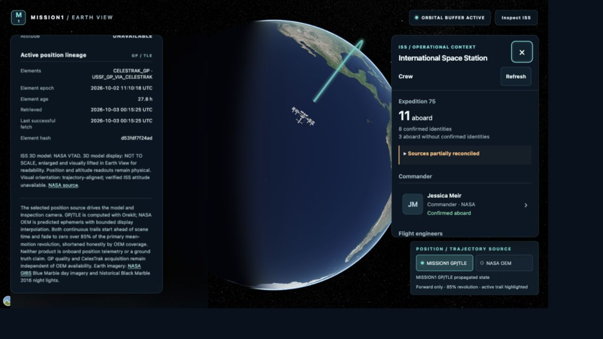
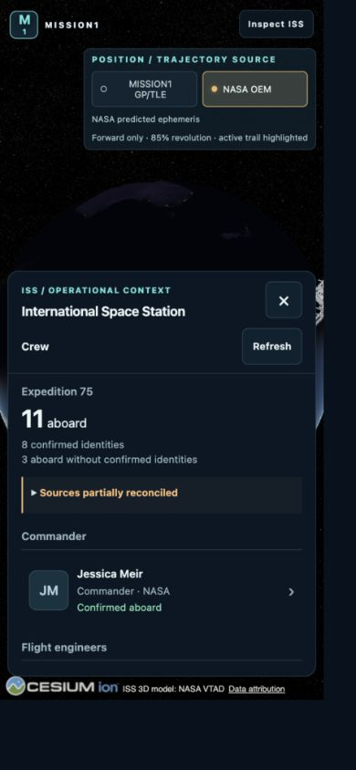
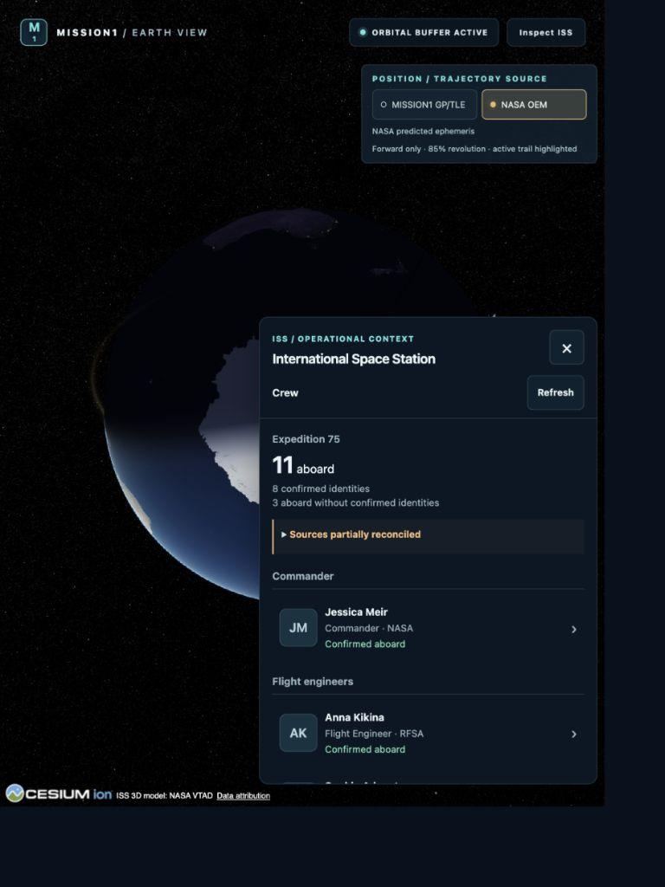

# ISS Crew Earth View panel review

Implemented on 2026-10-03 from accepted, synchronized `main` commit
`6d2d45b780e4703afe5f3c87576b1022ffe929eb` (`feat: expose ISS crew REST API`).
The working repository is `/Users/daniel/Desktop/MISSION1`. The original project
context, `/Users/daniel/Desktop/mission1-project.md`, is maintained separately and
is outside Git.

The Crew panel is available from **ISS Crew** in the existing orbital information
surface in both Earth Overview and Inspection. It is a bounded DOM overlay with
its own scrolling content, a persistent header, manual Refresh, member detail,
Back and Close. Opening Crew clears the module information panel; selecting a
real ISS module closes Crew. Opening Crew does not request Inspection or change
the camera or orbital source.

## Context and architecture

Reviewed the project instructions and current external context, frontend README,
camera/Inspection/perceptual/focus reviews, Crew domain/authority/persistence/NASA
verification/validation documents, implemented API and superseded draft,
architecture 03/05, ADRs 0007–0009 and the backend README. Applied the frontend
design, Earth/station views, API, quality/provenance, local platform, ground-segment
architecture, software architecture and ADR skills. Pipeline and Orekit skills
were consulted for the ingestion and graphics boundaries.

The existing app owns orbital delivery, source selection, view-mode requests and
module selection. `EarthView` continues to own the Cesium Viewer, scene, model,
camera, accepted transition controller and orbital rendering. Crew adds local
panel selection to `App`; stable existing EarthView props retain their identity.

```text
Existing persisted Crew REST resources
  → crewApi.ts (same-origin read-only JSON + guarded decoders)
  → useCrewResource.ts (mounted resource, abort, manual refresh)
  → CrewPanel → CrewSummary / CrewMemberDetail → DOM

Existing orbital delivery → EarthView → unchanged Cesium scene
```

There is no Crew dependency on Cesium, `preRender`, the orbital clock, source
adapters or scheduling. The memoized Crew panel does not consume the app's
changing orbital position/time. There is no new store, query library, server,
endpoint, migration, scheduler or backend source change. `jsdom` 30.1.1 is the
only added dependency and is used for mounted React tests, not production.
The dependency audit reports the same three high advisories in
`braces`/`chokidar`/`vite-plugin-static-copy` as the accepted baseline; no new
advisory package is introduced. See [validation-summary.json](validation-summary.json).

No new ADR was needed. ADRs 0007–0009 already define source authority, UUIDs,
immutable history and reconciled interpretation. This consumer implements the
existing architecture; architecture 05 records the UI boundary and ownership.

## Counts, people and quality

The station name and Expedition summary come from the collection. Its current
official aboard count is primary; null means unavailable. A retained count is
explicitly labeled last reported/currently unverified. The resolved count and
positive unidentified count gap are separate. Source details label structured
assignments and the number of displayed profiles. The UI never equates these
five quantities or derives an authoritative count from an array length.

| Quantity | Recorded real response, 2026-10-03 14:17:36 UTC |
| --- | ---: |
| Current official aboard | 11 |
| Confirmed resolved identities | 8 |
| Unidentified aboard count gap | 3 |
| Unresolved assertion-subject entries | 3 |
| Structured Expedition assignments | 7 |
| Resolved profiles rendered | 9 |

These are a dated persisted response, not permanent constants or a claim about
live onboard telemetry. Expedition was **Expedition 75** and reconciliation was
**PARTIAL_MATCH**. Full public DTOs and request receipt times are in
[real-api-smoke.json](real-api-smoke.json) and
[real-crew-response.json](real-crew-response.json).

Groups use backend `roleCode`: Commander, Flight engineers, other assignments,
other confirmed crew and other presence context. Jessica Meir is Commander with
confirmed presence. LL2+NASA people retain both assignment and presence. LL2-only
Andrei Fedyaev retains a Flight Engineer assignment with **Presence unverified**.
NASA-only resolved Luke Delaney and Jessica Watkins are **Confirmed aboard** with
**No structured assignment**; neither gets an invented role or agency.

Unresolved NASA entries are informational list items without a UUID, link,
clickable card or fabricated canonical presence. They retain the original name,
assertion type/status, identity-resolution state, applicability and UTC source
time. In the recorded response, Joshua Kutryk and Sergey Teteryatnikov are
completed reported-entry assertions; Andrey Fedyaev is a reported-aboard
assertion. The UI does not merge Andrei/Andrey or equate three report entries to
three newly identified people.

| Backend reconciliation status | Always-visible wording |
| --- | --- |
| MATCH | Sources aligned |
| NASA_AHEAD | Recent NASA update |
| LL2_AHEAD | Structured roster newer |
| PARTIAL_MATCH | Sources partially reconciled |
| PRIMARY_UNAVAILABLE | Structured roster unavailable |
| VERIFICATION_UNAVAILABLE | NASA verification unavailable |
| STALE | Crew data may be outdated |
| AMBIGUOUS | Crew state requires reconciliation |

A compact native disclosure explains the status. Stale and failed source-refresh
notes remain visible independently. All six presence states have explicit text:
Confirmed aboard, Confirmed not aboard, Presence unverified, Presence unknown,
Presence outdated (with last-known state when supplied), Presence ambiguous.
Assignment never implies presence. A degraded HTTP 200 remains a useful data
panel. A 503 is a separate alert with Retry; a failed manual refresh retains the
previous dated assessment and explicitly says it was not updated.

Source disclosures distinguish backend evaluation/reconciliation, last
successful acquisition, original observation and publication times. Repeated
GETs are never presented as newly acquired NASA/LL2 observations.

## Member detail and media

Selecting a canonical member lazily fetches its UUID detail resource; the
collection is retained for Back. Detail shows agency, nationality, assignment
and validity, presence/as-of, quality/evaluation, biography, career totals,
official profile link, portrait rights and profile/presence evidence. Missing
values stay unavailable. NASA-only partial profiles remain useful; Luke Delaney's
real partial detail was inspected. HTTP 404/500/503 detail failures preserve the
member summary, allow Retry and leave Back functional.

Biographies render as escaped React text, with long text inside a native
disclosure and the existing panel scroll. ISO elapsed durations use integer
`BigInt` arithmetic, accept large hour/day totals and fractional seconds, and do
not use calendar dates. The real Meir response displays `436 d 6 h 28 min 11 s`
and `1 d 18 h 29 min`; these are cumulative source totals, not time on Expedition.

Portraits use a deliberately narrow reviewed permission: explicit NASA credit,
the NASA Image and Media Guidelines name and URL, and `singleUse: false`.
Unknown or restricted media is withheld. The
[official NASA guidance](https://www.nasa.gov/nasa-brand-center/images-and-media/)
supports factual informational use with credit and distinguishes third-party
rights; it is not blanket permission for every source image. The UI displays
credit, lazy loading and named alt text, with fixed dimensions and initials for
missing/restricted/broken images. The recorded Anil Menon portrait qualifies;
Meir's unknown/single-use image is withheld. URLs must be credential-free HTTPS.

## Responsive and accessibility acceptance

| CSS viewport | Final panel geometry and behavior |
| --- | --- |
| Desktop 1280×720 | Right panel 344px wide; top 82px, bottom 166px, height 472px; separate scrolling content; source selector below |
| Narrow desktop 900×700 | Right panel 310px wide; top 82px, bottom 166px, height 452px |
| Tablet 768×1024 | Bottom-right compact drawer 430px wide, about 594px high; underlying orbital surface hidden while open; source selector above |
| Mobile 390×844 | Bottom sheet about 372×490px, 9px side margins, 28px bottom plus safe area; map and source selector remain usable above |

Measured final tablet/mobile geometry is saved in
[responsive-tablet-final.json](responsive-tablet-final.json) and
[responsive-mobile-final.json](responsive-mobile-final.json). Earlier
[responsive.json](responsive.json) records the narrow viewport and the initial
tablet side-panel measurement; the final compact tablet drawer supersedes that
tablet measurement. Browser DPR was 1.1 in the final native run, so physical
override dimensions were adjusted and CSS `innerWidth/innerHeight` checked.
No document scrolling was observed. Mobile biography scroll reached about
1034px inside the panel while document scroll remained zero. Close and Back stay
in the fixed panel header/toolbar.

Controls are real buttons, lists, headings, named aside and native disclosures;
launcher has `aria-expanded`/`aria-controls`. Targets are at least 44px. Keyboard
opening focuses the heading; member detail focuses its heading; Back restores
the member button; Close restores the launcher after the mobile information
surface becomes visible. Scoped Escape returns from detail, then closes. There
is no modal backdrop or focus trap. Retry focuses the stable heading before
replacing the error control. Loading uses `role=status`; errors use `role=alert`.
Focus outlines were inspected with native keyboard navigation. Text is always
present alongside status color. Calculated text contrast on the opaque panel is
8.4:1 or greater for the checked normal/muted/status/accent colors; see
[contrast.json](contrast.json). Semantic/alt/error/focus behavior is tested; no
screen-reader hardware session was available.

## REST request and lifecycle evidence

Normal opening: **one** `/api/iss/crew`, **zero** person-detail or separate
Expedition requests. One selected member: **one** `/api/iss/crew/{UUID}`.
Returning to the retained list adds no request. Reopening fetches a fresh backend
assessment; Refresh/Retry are explicit new attempts. The Expedition client is
implemented and tested but unnecessary for this panel because the collection
already includes its summary. No direct LL2/NASA data request is made by the UI;
permitted image requests and user-invoked source links are distinct from data
ingestion.

The native slow-response fixture also recorded an `AbortError` after closing,
with no residual panel; see [browser-abort.json](browser-abort.json) and
`fixture-loading.png`. Shift+Tab from the Crew heading reached the existing
NASA GIBS reference outside Crew, confirming non-modal keyboard navigation.

Mounted tests verify no requests across five minutes of elapsed timer time,
unmount/selection cancellation, late responses that ignore abort, collection and
detail retries, and no N+1 detail fetch. Hooks use both AbortController and an
active-request guard; no polling, frame-loop fetch, fabricated cache freshness
or event-aware refresh was added.

[lifecycle-summary.json](lifecycle-summary.json) records ten native
open/detail/close cycles: exactly 20 requests, one Viewer throughout, one canvas,
zero residual panels/details/portrait elements and 162 DOM nodes after closing.
Cesium listeners remained preRender 3 / postRender 3 / clock 4, including the
QA observer itself. JS heap went from 204,444,484 to 197,958,190 bytes. No forced
GC or isolated GPU-memory instrument was used; this is bounded lifecycle evidence,
not a universal memory-leak proof.

## Graphics and browser QA

[frozen-files.json](frozen-files.json) compares 245 frozen files to the accepted
baseline, including 174 backend source/test/resource files. Existing Cesium,
orbital processing/control, model, texture and data files remain byte-identical.
Backend code, API contracts, ingestion, verification, identity resolution,
reconciliation, persistence and schedule/configuration are unchanged.

All 20 recorded Crew opening/closing comparisons have identical camera position,
direction, up vector, transform, FOV, selected source, multiplier and animation
policy. Scene epoch advances naturally (about 0.038–0.045 seconds between the
paired samples); Crew does not seek, pause or change the clock. See lifecycle
before/after reports and summary.

Native browser QA ran against the real backend on dev `5175` and the built
production preview `4175`, with desktop/mobile in both and additional narrow/
tablet layouts. Verified roster, Meir detail, NASA-only detail, source disclosures,
Back, Close, keyboard/focus, internal scrolling, Earth drag/wheel outside the
panel, GP/OEM selection, full Inspection/orbit/zoom/Back, Partial Back during
approach, and real semantic module selection (Tranquility). Panel exclusivity
was observed. No Crew background layer intercepts the exposed canvas.

**Native two-finger pinch remains unverified in this session.** The available
browser control supports drag/wheel but has no native pinch action; the user
could not test pinch. Accepted Cesium handlers/control files are unchanged and
retained control tests pass. This limitation is not recorded as a gesture pass.

All eight reconciliation wordings and isolated 503/retry/detail-error states were
also inspected in the browser using explicit **QA FIXTURE** pages. See
[browser-state-matrix.json](browser-state-matrix.json). These are presentation
fixtures with a visible label, not claims that the historical partial roster is
a valid backend MATCH/NASA_AHEAD/etc. reconciliation. Domain reconciliation is
tested in the unchanged backend. Six presence states and null/partial/error/media/
safe-biography/duration cases are covered by component/API tests.

The QA-only scripts below inject passive Viewer observation and optional explicit
fixtures through a disposable Vite config; the application does not import them.
No camera/clock writes, gesture simulation, production globals or observer nodes
were added. Production had zero observer/fixture nodes and no captured console
errors or warnings; see
[production-browser-checks.json](production-browser-checks.json). Served JS/CSS
match the built files by SHA-256 in [production-assets.json](production-assets.json).

## Local performance

Primary measurements use one browser tab, the same selected GP source and the
same viewer/viewport. These are local wall-clock observations, not SLAs, an
isolated GPU benchmark or an isolated React Profiler measurement.

| Panel state | Frame interval median / p95 | preRender→postRender CPU wall time median / p95 |
| --- | --- | --- |
| Closed | 20.0 / 21.6 ms | 5.6 / 6.1 ms |
| Crew list | 19.6 / 21.5 ms | 5.4 / 5.9 ms |
| Member detail | 19.9 / 21.4 ms | 5.5 / 6.0 ms |

Each primary bucket contains 1800 bounded samples. Initial list DOM mount was
4.4ms, data DOM 53.2ms and HTTP 44.9ms; detail mount 3.5ms, data DOM 55.2ms and
HTTP 51.1ms. Raw evidence is in `performance-single-closed/list/final.json`.
DOM latency includes React work, but does not isolate React commit cost.

An additional native scrolling run records closed/list medians of 22.4/22.7ms,
with 5.9/6.0ms CPU render medians. Sixteen alternating native wheel actions yielded
251 scrolling samples: interval median 19ms / p95 69ms and CPU render median
4.9ms / p95 5.9ms. Transient frame jitter occurred during input/automation; no
claim of perfectly stable scrolling or 60 FPS is made. See
[performance-scrolling.json](performance-scrolling.json). Earlier multi-tab
`performance-list/detail.json` captures slower shared-renderer conditions
(about 66ms frame intervals); the primary single-tab comparison supersedes it
for the idle closed/open comparison.

## Automated and real-runtime validation

| Check | Result |
| --- | --- |
| Frontend Vitest | 269 tests / 30 files, all passing; previous 171 / 26 retained |
| Frontend typecheck | Pass |
| Production build | Pass; existing large Cesium chunk warning remains |
| Maven test | 268 tests; zero failures/errors/skips |
| Maven verify | Pass; same 268 tests |
| Crew real API smoke | Collection, current Expedition and selected UUID details HTTP 200 |
| Orbital real API smoke | state, samples, comparison HTTP 200 |
| Dev / built production browser QA | Passed available checks; native pinch unverified |
| Production console | No captured errors/warnings |
| Frozen-file / scope review | Pass; backend and accepted graphics code unchanged |
| Git whitespace check | `git diff --check` passed |

Frontend validation uses Node 24; backend uses Java 21, existing Docker PostgreSQL
and Maven's populated offline dependencies. Reproduction:

```sh
cd /Users/daniel/Desktop/MISSION1/frontend
PATH=/opt/homebrew/opt/node@24/bin:$PATH npm test
PATH=/opt/homebrew/opt/node@24/bin:$PATH npm run typecheck
PATH=/opt/homebrew/opt/node@24/bin:$PATH npm run build
cd /Users/daniel/Desktop/MISSION1/backend
mvn -o test
mvn -o verify
```

For the isolated optional QA instrumentation (never the production server):

```sh
cd /Users/daniel/Desktop/MISSION1/frontend
PATH=/opt/homebrew/opt/node@24/bin:$PATH npm exec vite -- --config ../docs/frontend/crew-earth-view-panel-review/scripts/qa.config.mjs
```

## Visual evidence

Real screenshots were inspected, including the revised tablet composition:





Additional evidence:

- `desktop-partial-match.png`, `desktop-detail.png`, `desktop-unresolved.png`, `desktop-sources.png`.
- `narrow-desktop.png`, `mobile-list.png`, `mobile-detail.png`, `mobile-nasa-only.png`.
- `production-detail.png`, `production-mobile-detail.png`, `production-mobile-biography.png`.
- `crew-earth-interaction.png`, `crew-inspection.png`, `production-gp-inspection.png`, `production-oem-inspection.png`.
- `production-module-selection.png`, `production-partial-back.png` and the paired approach/return accessibility text.
- Explicit fixture screenshots: stale, ambiguous, primary/verification unavailable, API 503, successful Retry and detail failure.

## Documentation and next scope

Updated frontend README; Crew README, domain contract, source authority, NASA
verification and validation/regression; implemented Crew API consumer notes;
architecture 03 roadmap and 05 operational context; backend README. This dossier
records implementation/visual/runtime evidence. The external project context is
updated separately and remains outside Git.

No event timeline, notifications, history/Replay, editing, new backend resource or
event-triggered refresh was started. RTN trajectory-separation analysis and Replay
remain pending. The next single milestone is **ISS CREW EVENT-AWARE REFRESH**.
