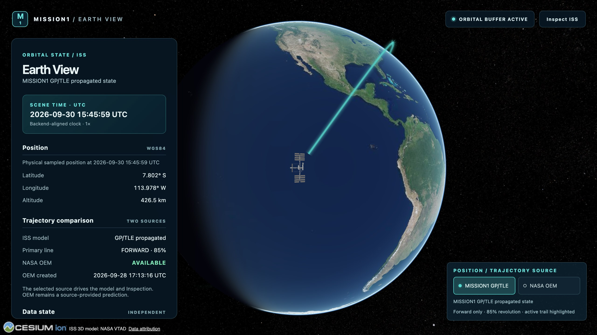
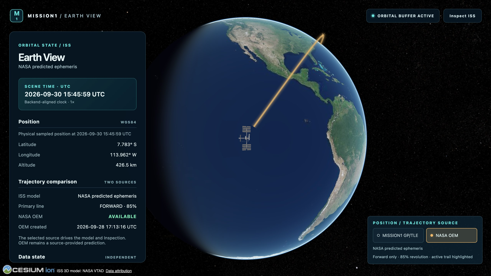

# Adaptive forward ISS trajectory presentation — 2026-09-30

## Elevated Inspection and rendering stability — 2026-10-01

The current canonical desktop camera uses a **90 m slant range**, **42.5° rear elevation**, zero lateral offset and **100° FOV**. Its trajectory-frame offset is calculated as `(-90 cos(42.5°), 0, 90 sin(42.5°))`, approximately **(−66.354960, 0, 60.803119) m**. Scale remains 1 and Overview minimumPixelSize remains 80. Narrow aspect ratios widen the range by `max(1, 1.2/aspect)` while retaining elevation. Inspection orbital details start collapsed and remain keyboard-accessible, keeping the left solar array visible.

Entry and exit share a retained pose pipeline and a monotonic **5-second** transition parameter. Quintic smootherstep coordinates logarithmic range, spherical direction, quaternion orientation and FOV. Entry smoothly acquires the current selected-source frame; its endpoint is the physical model centre. Earth-intersecting routes use one preflighted Earth-centred great-circle arc with a smooth radial bulge, without an acquisition stage. Exit follows the initial station-relative point while blending to the captured world pose; it restores FOV, near/far planes and the controller profile captured at entry. Interrupted entry retains incoming position/orientation/FOV and presentation tangents, settling those corrections over the first 0.6 seconds. Lift and silhouette use the same parameter and C2 easing; lift still disappears by 35% of entry (1.75 s), remains model-only, and returns over the 5-second exit.

The default Cesium environment-map invalidation at every 1 km caused repeated draw-command/shader regeneration as orbital motion and 75 km display lift changed the model translation. Generate that approximate ambient environment once, retaining its full diffuse/specular maps; position/time invalidation tolerances are infinite. Direct Sun, Earth lighting, terminator and historical city imagery continue to follow scene UTC. Ambient reflections are a stable visualization approximation, not an ISS radiometric simulation. A public CustomShader filters unresolved normal variance into bounded specular roughness; source base colors, metallic factors, normal maps and PNG bytes remain inputs. MSAA 4 remains active; complementary FXAA reduces thin-edge outliers during entry, Inspection and exit, while Overview keeps MSAA alone on supported hardware. All modes retain native DPR resolution. The public silhouette width/alpha stay at imperceptible positive floors (1e-6 px / 1e-12) in Inspection so Cesium can retain a valid compiled pipeline; the visible outline is zero. Back-face culling is restored there. Overview still uses 0.5 px / alpha 0.12. Ground fog is confined below 100 km (with compensated ground density), avoiding the model shader rebuild at Cesium's default 800 km ceiling. Close-view atmospheric shaders warm during model loading. A retained native-resolution FXAA stage uses a uniform bypass in Overview, so changing modes does not destroy/reallocate its GPU resources. No asset, geometry, source contract, low-resolution LOD or texture reload is introduced.

[Diagnosis, framing trials, browser checks, raw frame times and remaining limits](inspection-rendering-optimization-review/README.md). Earlier dated sections below retain historical behavior and are superseded by this section.


## Selected trajectory visual frame — 2026-09-30

The selected bounded physical position and ITRF velocity at the same scene UTC now drive model rotation and the moving Inspection camera frame. GP forwards its existing Orekit Earth-fixed PV; OEM differentiates its existing source Hermite polynomial and transforms the complete PV, including Earth rotation. REST adds three velocity components and explicit m/s units. Separate bounded browser velocity interpolation leaves physical position interpolation, original trajectory vertices, provenance and source classifications unchanged.

The verified asset has render-local +X forward / +Z up. Model-only lift changes translation separately; orientation is labeled `TRAJECTORY_ALIGNED_VISUAL_ORIENTATION`, with verified attitude still unavailable. Existing cyan/amber/inactive colors, continuous future-only 85% trails, adaptive screen-space gap, rounded starts and Overview silhouette remain. Inspection hides the paths, removes lift/silhouette and uses the same selected physical pivot. No RTN comparison is introduced.

[Axis verification, numerical alignment, source switching and browser review](inspection-orientation-review/README.md). [Rear camera and navigation](iss-inspection-mode.md).

Earlier dated evidence below records preceding milestones; the section above describes the current behavior.

[ADR-0006](../adr/0006-selectable-forward-trajectory-visualization.md) retains selectable real products and its physical/display boundary. The [current verification record](trajectory-presentation-review/README.md) replaces the fixed 75-second start and disabled silhouette of `389736f`. Historical measurements below remain dated evidence.

## Current rendering

Each own bounded `SampledPositionProperty` supplies the start of its real source path. A sub-sample temporal search resolves the earliest future projected centerline exit from a conservative displayed-model hull, to 1 ms, at at most 10 Hz. The source window is never extrapolated. Only temporal/material uniforms change; original `ArcType.NONE` source vertices, layer widths and coverage remain intact. Geometry is replaced only for a new response, as a complete ready group.

Camera range is Euclidean distance to the selected physical point plus its 75 km WGS84-normal display lift. It is not distance to Earth center. The smooth target is:

```text
p = clamp(log(max(range, 2,000,000) / 2,000,000) / log(17,000,000 / 2,000,000), 0, 1)
desiredGapCSS = 0.75 + (4 − 0.75) × p²(3 − 2p)
```

The model hull projects the pinned GLB's eight conservative bounds corners with its off-origin model matrix and current public minimumPixelSize/maximumScale policy. The public `Model.boundingSphere` alone excludes minimum-pixel display enlargement. `Camera.getPixelSize` and `SceneTransforms.worldToWindowCoordinates` supply the projection without private renderer fields.

The existing public Fabric/PolylineGlow composition now multiplies alpha by a short start smoothstep and applies a matching width mask using `st.t`. The ramp spans **1–4 projected CSS pixels**, converted to seconds with the own-source local projected rate (about 8.44 / 1.91 / 0.193 s in the canonical far / medium / close views). Alpha and width start at zero; no hard flat cut, separate start dot or displaced cap is introduced. The original inverse-smoothstep endpoint fade and **0.85 primary-period** horizon persist.

A public Fabric submaterial evaluates every halo/body fragment against the hull plus silhouette. CSS conversion uses drawing-buffer dimensions and canvas CSS dimensions, independently of DPR. Fragments inside the envelope are transparent; the margin softens across 0.75 CSS pixel. This protects the complete **20/8 px** envelope instead of assuming a centerline clearance implies a visible clearance. The inexpensive mask follows every frame, including camera movement; source searches remain throttled. Failed projection or insufficient source coverage hides the affected trail instead of extrapolating. Native Earth depth remains.

Both builds measured **6 > 4.5 > 3 > 0 CSS px**, at 17,000 / 6,000 / 1,500 km range, for both selections. The target is a lower bound relative to a conservative envelope; actual visible margins include taper, glow, silhouette and anti-aliasing. The [raw times, distances and pixel method](trajectory-presentation-review/README.md) explain the difference. These views establish the requested zoom behavior; extreme oblique or occulted poses can have larger physical separations and are not a universal pixel-order guarantee.

## Station and physical values

Overview keeps `minimumPixelSize=80`, physical scale 1, maximumScale 20000 and **75 km model-only WGS84-normal lift**. Public `Model.silhouetteColor` is white / alpha **0.12**, `silhouetteSize` **0.5**. The 12 restrained trials selected the smallest pair. It remains in ready Overview, fades smoothly to zero with the lift by the first 1.75 seconds of entry, remains zero in Inspection and restores over 1.2 seconds from the captured current values. The NASA textures/PBR, ready-model picking and loading/failure locator persist.

Selected physical position, altitude, backend velocity, scene/source UTC, propagation, travel time and all trajectory vertices remain independent of lift. The separate display-output helper rejects aliasing the canonical input. Browser lift on/off observations at fixed UTC confirm a 75,000 m model translation, unchanged physical values and an identical trajectory-vertex hash for both GP/TLE and OEM. Inspection pivot error and camera-position handoff discontinuity are 0 m in both builds/sources. No velocity is derived from displayed positions. API samples remain physical.

The selected colors remain PRIMARY cyan `#53d9cd`, OEM amber `#edb86a`, inactive `#71939c`; alpha 0.85/0.08, halo multiplier 0.26 and glow 0.35/0.22. Inactive halo/body precedes active halo/body. GP stays `COMPUTED_FROM_ORBITAL_ELEMENTS`; OEM stays `SOURCE_PROVIDED_PREDICTED_EPHEMERIS`. No new source, measurement, accuracy claim, backend behavior, RTN analytics or Replay is added.

The [full review](trajectory-presentation-review/README.md) contains runtime identity, source-lineage observations, trials, browser regressions, tests and comparable performance. Public references: [Model](https://cesium.com/learn/cesiumjs/ref-doc/Model.html), [Material](https://cesium.com/learn/cesiumjs/ref-doc/Material.html), [Camera.getPixelSize](https://cesium.com/learn/cesiumjs/ref-doc/Camera.html#getPixelSize) and [SceneTransforms](https://cesium.com/learn/cesiumjs/ref-doc/SceneTransforms.html), checked with pinned 1.145 implementation.

---

# Prior selectable trajectory correction — 2026-09-30

The renderer at commit `389736f` followed [ADR-0006](../adr/0006-selectable-forward-trajectory-visualization.md) and its dated presentation correction. The user rejected the first `8146055` result; this milestone reproduces and fixes its visual deficiencies in development and served production. The full [verification record](trajectory-fix-review/README.md) contains context, runtime identity, numerical source positions, controlled trials, browser matrix, Inspection discontinuities, tests and performance. Earlier centered/dashed rendering below and initial selection evidence in `trajectory-selection-review/` remain historical, not the current decision.

## Prior verified behavior

| Reported issue | Finding and correction |
| --- | --- |
| Color appears unchanged | State, retained materials and order already switched, but both active paths were cyan and subpixel-coincident. PRIMARY is now cyan `#53d9cd`; OEM amber `#edb86a`; inactive `#71939c` alpha 0.08. Active alpha remains 0.85. |
| ISS appears not to move | Physical switching was correct. Fixed-UTC products differ by 2979.925 m, projecting to 0.199 CSS pixel. This is EXPECTED; no fake source displacement is added. |
| Gap appears absent | 40/50 s contacted the enhanced model; 60 s was marginal. **75 s** was the smallest clearly sufficient tested gap. Final PRIMARY/OEM full-halo margins were about **5 CSS pixels**. |
| ISS still too large | Controlled 92/88/84/80 trials selected **80**, about 13.4% less visible height and 23% less footprint area than 92 in that view. Physical asset scale 1 and maximumScale 20000 remain. |
| Station appears on Earth | Tested 0/2/5/8/10 km, then 25/50/75/100 km. **75 km model-only normal lift** was the smallest tested lift giving several pixels of extra limb clearance. Physical state/readout/trajectory/Inspection pivot are unchanged. |





The selected bounded physical point remains shared by the readout, loading locator, approach target and moving ENU Inspection pivot. The model receives a separate display point: selected physical point plus WGS84-normal lift in Overview. Lift smoothly reaches zero within the first 1.75 seconds of entry, is zero in Inspection, and returns over 1.2 seconds on Back. Model minimum footprint grows 80→158 and returns to 80. Both source approaches measured **0 m camera-position handoff discontinuity** in both builds; final pivot error was 0 m. No silhouette is enabled because smaller-plus-lift satisfied reviewed contrast. Ready model picking, feature readiness and loading/error locator behavior remain intact.

## Source and geometry policy

GP/TLE remains mandatory, session default and `COMPUTED_FROM_ORBITAL_ELEMENTS`. NASA OEM remains bounded `SOURCE_PROVIDED_PREDICTED_EPHEMERIS`, explicitly **NASA predicted ephemeris**. Neither is ground truth, onboard telemetry or automatically more accurate. Element/creation epochs, retrieval, hash, coverage, scene UTC and physical meters/WGS84 altitude remain distinguishable. Stored GP was honestly `STALE / ELEMENT_TOO_OLD`, acquisition `UNKNOWN` with refresh disabled for this local review.

OEM selection requires real source and sample coverage plus the existing 300-second response-display lifetime. Covered degraded predictions remain labeled degraded. Controls lock outside Overview. Invalid selected OEM exits Inspection and explicitly returns to GP/TLE. No freeze or extrapolation occurs. The existing normal <=3-second poll-alignment seam retains the preceding still-valid moving product until the next one covers scene time; true loss is accepted immediately.

Each source retains two unclosed, coincident, non-pickable `ArcType.NONE` halo/body primitives, 20/8 px, alpha scale 0.26/1, glow power 0.35/0.22. Actual collection order is inactive halo/body followed by active halo/body. Normal Cesium depth and order-independent translucent rendering remain enabled; the brighter distinct active accent and dim inactive alpha establish the visible hierarchy. No curve offsets or arbitrary rerenders are added. Only response replacement rebuilds geometry; selection and scene ticks mutate retained material uniforms.

The temporal mask renders `[sceneTime+75s, sceneTime+0.85T)`, shortening OEM at actual coverage. `T=86400/meanMotion`, 5578.924303429717 s for the reviewed real element set. Public Fabric composes PolylineGlow with inverse smoothstep:

```text
u = (sampleTime − visibleStart) / (visibleEnd − visibleStart)
alphaMultiplier = 1 − u²(3 − 2u),  0 ≤ u < 1
alphaMultiplier = 0 outside that interval
```

No past/rear line, fade-in, periodic wrap, copied endpoint, bridge or closure exists. Source sample geometry stays physical; clipping the start uses its genuine bounded sampled segments. All source points remain unmodified. Both trails hide outside Overview. Display lift never enters the geometry or API.

## Acceptance evidence and limits

[Controlled size/gap crops](trajectory-fix-review/controlled-trials.jpg) and [lift trials](trajectory-fix-review/lift-trials.json) explain the selected values. The crop grid's gap row combines the measured isolated model/trail layers for controlled review; full-page screenshots show the actual browser render. The [complete browser matrix](trajectory-fix-review/README.md#f--inspection-and-browser-matrix) covers both sources, repeated switches, gap/fade/rotation, day/night/terminator, medium/global views, direct picking, both Inspection entries, Back, unavailable OEM, OEM loss during Inspection, delayed GLB and 390-pixel mobile layouts in both builds. No application/WebGL errors were observed. QA availability/latency stubs left real coordinates unchanged; no temporary diagnostics entered production source.

Frontend **66 tests / 14 files**, typecheck and production build passed. Backend **82 tests**, Java 21 Maven test/verify passed, no failures/errors/skips. The existing Cesium bundle warning remains. Identical frozen UTC/camera at **2560×1440**, DPR 2, 4× MSAA and one active view measured median **24.905 FPS untouched `8146055` / 24.171 FPS final**, five steady windows each after warmup: −2.95%, no material local regression detected. GPU memory is uninstrumented; cache/imagery/warmup variability limits inference. The older ~19 FPS reference used different workload conditions.

Measurements establish the reviewed views, not every possible camera/occlusion configuration. Normal lift projects little near nadir; Earth occultation remains credible. The model is enlarged and visually lifted **NOT TO SCALE**; physical readout/altitude and source semantics remain explicit. Public Cesium [Model](https://cesium.com/learn/cesiumjs/ref-doc/Model.html), [Material](https://cesium.com/learn/cesiumjs/ref-doc/Material.html) and [PrimitiveCollection](https://cesium.com/learn/cesiumjs/ref-doc/PrimitiveCollection.html), together with pinned 1.145 source, informed the lifecycle, sizing and material checks.

No backend orbital behavior, RTN analytics, Replay or new telemetry feature was added. The next milestone remains **GP/TLE ↔ NASA OEM RTN TRAJECTORY-SEPARATION ANALYSIS**, not started.

---

## Historical correction before source selection

### Orbital trajectory presentation correction — earlier 2026-09-30 milestone

Scope: endpoint and overlap diagnosis, primary trail/OEM differentiation, ready ISS locator removal. Backend propagation, source selection, interpolation, API windows, attitude and physics are unchanged. The full RTN analytics milestone is deferred.

## Baseline reproduction and diagnosis order

Before editing, development and served production showed the sharp cyan 4 px primary, a dense amber OEM dash (2.5 px, cycle 18 px, pattern `0x00ff`), and a persistent locator/label over the ready model. Inspection entry/exit was reproduced. The original primary was already one continuous per-vertex-colored primitive; its 15 s alpha refresh replaced geometry after readiness. Numerical diagnosis was completed before material changes. A clean archive of parent commit `0150d9f` was subsequently served separately to compare FPS against the final source.

### Recorded real-source window

The [captured comparison response](trajectory-review/diagnostic-comparison.json) is an observation used for this diagnosis, not a runtime fallback. Current state remained honestly labeled `STALE / ELEMENT_TOO_OLD` for this stored set.

```text
TLE line 1: 1 25544U 98067A   26272.11005302  .00004557  00000+0  91790-4 0  9991
TLE line 2: 2 25544  51.6312 145.7721 0007123 200.7262 159.3438 15.48685648587861
Element epoch: 2026-09-29T02:38:28.580928Z
Retrieved:     2026-09-29T18:50:20.789922Z
Element SHA256: c1278ac312d701dc21def7fbdefa271c7629648e65365277c17962c2d09086ea
Provider/origin: CELESTRAK_GP / USSF_GP_VIA_CELESTRAK
T0:       2026-09-30T11:29:18.225693Z
Period:   86400 / 15.48685648 = 5578.924303429717 s (92.9820717 min)
First:    2026-09-30T10:42:48.763541285Z
Last:     2026-09-30T12:15:47.687844715Z
Count:    181, center index 90, 180 equal temporal intervals
```

First and last are `t0 ± T/2`, rounded to nanoseconds. All epochs are unique and strictly ordered; no sample or endpoint is missing. The browser's strengthened validation permits 2 ms for its millisecond timestamp representation and requires every sample to lie on the uniform phase grid.

### Endpoint values

XYZ positions are meters. TEME states came from the selected production Orekit propagator; TEME was transformed **at each endpoint epoch** to a common EME2000 frame using the same pinned Orekit/EOP context. The inertial result is not obtained by comparing Earth-fixed vectors.

| Frame | First XYZ (m) | Last XYZ (m) | Endpoint distance |
| --- | --- | --- | ---: |
| TEME | (3954527.672035, 1988015.726101, −5162451.740423) | (3947593.700244, 1987445.823122, −5167975.634457) | 8883.589 m |
| EME2000 common inertial | (3952834.809255, 1964161.429224, −5172868.687586) | (3945883.093162, 1963632.779446, −5178374.455655) | 8883.654 m |
| ITRF 2020/IERS 2010 | (−3544618.557888, −2650690.224692, −5162453.315808) | (−4297298.488818, −1032801.479945, −5167974.061840) | 1784410.700 m |

| WGS84 | First | Last | Last − first |
| --- | ---: | ---: | ---: |
| Latitude | −49.569268860° | −49.640711495° | −0.071442635° |
| Longitude | −143.210606391° | −166.485990209° | −23.275383819° |
| Altitude | 434315.183628 m | 434341.940607 m | +26.756979 m |

Common-frame position angular residual: **0.074851203°**. Signed in-plane phase residual: **+0.042391805°**, from `atan2(r1·tangent0, r1·radial0)` with radial0 = normalized first position, normal0 = normalized first `r×v`, tangent0 = normal0×radial0. It describes the residual after approximately one revolution, not total accumulated phase. The mean-motion period is not a guarantee of exact geometric closure of a perturbed SGP4 orbit. Earth rotates approximately 23.31° during this period; the measured longitude change and much larger ITRF distance explain the apparent far-side gap.

**Classification: `EXPECTED_EARTH_FIXED_NON_CLOSURE`, with `ITRF_FRAME_EFFECT`.** The harsh baseline endpoint alpha (0.08) increased the impression of a broken line. There was no off-by-one, window asymmetry, duplicated/missing endpoint or segmentation seam in this capture. OEM covered the complete 181-point window, so an OEM coverage boundary did not explain this case. Orbital state varies continuously in time; the first/last positions at different epochs are not required to be the same point.

## Measured GP/TLE–OEM proximity

The captured NASA OEM file has source creation `2026-09-28T17:13:16.701Z`, coverage `2026-09-28T12:00:00Z` through `2026-10-13T12:00:00Z`, retrieval `2026-09-30T10:52:58.531150Z`, HTTP Last-Modified `2026-09-28T17:27:12Z`, SHA256 `14f2dce1e0263fba4fee8e042a89173ec632768f8cd54190e7c0d99040ef2433`.

Both delivered products are ITRF 2020/IERS 2010 in meters, with exactly matching UTC epochs. The existing backend evaluates bounded cubic Hermite interpolation from OEM EME2000 source position/velocity and performs the epoch-specific EME2000→ITRF transform. Diagnostic Euclidean subtraction is therefore frame/time aligned; no TEME–EME2000 subtraction occurs.

| 181 aligned pairs | Separation |
| --- | ---: |
| Minimum | 2522.007638 m |
| Median | 3294.596414 m |
| Maximum | 3713.372130 m |

Reproduce these distances from the checked-in capture with Python `math.dist` over `(xMeters,yMeters,zMeters)` for equal `time`, then `min`, `statistics.median`, `max`. This is a diagnostic snapshot, not persisted analytics or an accuracy/ground-truth claim.

**Yes: physical proximity is the primary reason the curves look alike.** At about 330 px Earth radius, 3.713 km is less than 0.2 px in an Earth-scale projection, while original line widths were 4 and 2.5 px. Near-total overdraw is expected. Dense 9 px on/9 px off OEM dashes, modest contrast and primary core overdraw added a rendering contribution. The corrected sparse contrast treatment changes detectability without moving either centerline.

## Selected visual design

### Primary: actual temporal orbit, soft envelope

One exact 181-point unclosed sequence, `ArcType.NONE`. No spatial perturbation, copied endpoint, loop, closing interpolation or reference-ring substitution. Two coincident `PolylineGeometry` primitives share the same positions array:

| Layer | Width | Alpha multiplier | Glow power |
| --- | ---: | ---: | ---: |
| Halo | 20 px | 0.26 | 0.35 |
| Body | 8 px | 1 | 0.22 |

Color `#53d9cd`. Given cycles `c = abs(sampleTime − sceneTime)/T`, phase `p = c − floor(c)`, normalized orbital phase distance `d = 2×min(p,1−p)`:

```text
alpha(d) = 0.025 + 0.825 × (1 − d² × (3 − 2d)),  0 ≤ d ≤ 1
```

Peak 0.85 at ISS; monotonic and symmetric; minimum 0.025 half a revolution away. Smoothstep has zero slope at both bounds. Halo minimum is 0.0065. Glow edge alpha multiplies the phase envelope; the finite trail center remains nonzero on the far side. Camera occultation can still hide any part behind Earth.

Built-in `PolylineGlow` was evaluated first. Unmodified emission made a white, laser-like center; a constant halo also weakened the opposite-side fade. The existing per-vertex alpha geometry was already continuous and had no segmentation defect, but color alone lacked soft edges. The selected **public Fabric composition** uses built-in `PolylineGlow` for edge alpha and built-in `Fade` for periodic phase distance, with restrained cyan emission. No handwritten shader source, private APIs or animated/procedural noise are required. `taperPower=1` disables a one-direction taper, preserving past/future symmetry. Since Cesium's polyline `st.s` is sample index divided by 180 and the API grid is uniform in time, phase texture coordinates represent the specified temporal fade.

Each tick changes only the Fade phase uniform. Geometry rebuilds only for a new comparison response; both replacement primitives prepare hidden and are revealed together when ready while the old group persists. Layers are non-pickable and their primitives/materials are destroyed on replacement/unmount. OEM/model picking and globe depth remain independent.

### OEM: secondary, uniform and sparse

Supported `PolylineDashMaterialProperty`: orange `#ff984f`, width **5.5 px**, fixed alpha **0.92**, transparent gap, **64 px** cycle, **`0x000f`** 16-bit pattern (16 px on / 48 px off). No phase fade or organic modulation. The broader low-alpha primary envelope remains visible around OEM dashes and within gaps even when centerlines project onto the same pixels. World-space coordinates remain unchanged. Cesium's native depth testing is retained; no depth-fail material or global depth override is introduced.

### ISS lifecycle and interaction

Ready model only: no point and no label at any valid Overview range. `minimumPixelSize` **72→96** increases its existing bounded display enhancement; maximumScale and physical asset scale remain unchanged, and the UI still says **NOT TO SCALE**. The model's existing feature/id picking is the interaction target. Loading or failure keeps the temporary locator/label with valid buffered positions; expiry hides both. Inspection approach, moving ENU target, module picking and smooth return persist, and both large paths hide in Inspection.

## Verification evidence

Development and served production were checked with real stored sources. Controlled localhost proxies exercised OEM `UNAVAILABLE` and delayed GLB loading, while passing the real primary/model sampled coordinates unchanged. They are QA-only processes, not runtime source changes or synthetic ISS observations.

Browser matrix and local performance results are recorded below. Screenshots are evidence of one time/camera composition, not pixel regression tests.

## Public Cesium references

- [Material and built-in material parameters](https://cesium.com/learn/cesiumjs/ref-doc/Material.html)
- [Public Fabric composition](https://github.com/CesiumGS/cesium/wiki/Fabric)
- [PolylineGeometry](https://cesium.com/learn/cesiumjs/ref-doc/PolylineGeometry.html)
- [PolylineMaterialAppearance](https://cesium.com/learn/cesiumjs/ref-doc/PolylineMaterialAppearance.html)
- [PolylineDashMaterialProperty](https://cesium.com/learn/cesiumjs/ref-doc/PolylineDashMaterialProperty.html)

The pinned Cesium 1.145 implementation was also checked for normalized per-index texture coordinates and material uniform-only updates.

### Manual browser matrix

| Case | Development | Served production |
| --- | --- | --- |
| Global daytime Overview / bright Blue Marble | Pass | Pass; [day](trajectory-review/production-day.jpg) |
| Global nighttime / historical city-light regions | Pass; [night](trajectory-review/development-night.jpg) | Pass; [night/endpoints](trajectory-review/production-night-endpoints.jpg) |
| Terminator | Pass | Pass; [terminator](trajectory-review/production-terminator.jpg) |
| Opposite orbital phase and actual distinct endpoints | Faint trail retained when not occulted | Faint trail retained when not occulted; no bridge |
| Globe rotation / Earth depth | Native drags; correct occultation | Native drags; correct occultation |
| Zoom in and out / intermediate dash readability | Pass | Pass |
| Ready model without point or label | Pass | Pass |
| Direct model click → approach → Inspection | Pass; solar-array surface click | Pass; visible model click |
| Inspection → Overview / moving target / uncluttered paths | Pass; [inspection](trajectory-review/development-inspection.jpg) | Pass |
| Real 120 s comparison/window refreshes | Several refreshes; ready replacement retained, no observed popping | Repeated refreshes; same group-readiness behavior |
| OEM unavailable | Controlled localhost response; [primary/model remain](trajectory-review/development-oem-unavailable.jpg) | Controlled localhost response; [primary/model remain](trajectory-review/production-oem-unavailable.jpg) |
| Delayed GLB → ready | Temporary locator observed, hidden at readiness | Temporary locator observed; [early loading](trajectory-review/production-loading-fallback.jpg), hidden at readiness |
| Semantic picking | Existing routing tests pass | Actual Poisk click opens the matching module panel |

The early loading screenshot includes the locator before globe imagery finishes. The QA proxy delayed the GLB by 12 s; readiness was about 13.1 s in production and 13.7 s in development. It changed only optional OEM availability/empty samples and asset delivery delay, leaving the real primary coordinates intact. Development HMR WebSocket forwarding was outside this temporary HTTP proxy; normal development and served-production renderer logs were checked separately.

No shimmer, crawling texture, alpha flicker, or segment popping was observed during the sampled rotation/zoom/approach/refresh checks. Final clean development and production tabs reported no application/WebGL errors. An earlier experimental Fabric child name `glow` collided with a local identifier inside the built-in shader; using the distinct child name `edgeGlow` resolved it before final validation. This discarded intermediate trial is not a residual production error. Manual observation is not an exhaustive guarantee on other GPUs.

### Visual review answers

1. **Softer/organic:** yes, a translucent feathered envelope replaces the sharp flat line; no unstable noise is needed.
2. **Exact computed centerline:** yes, both layers receive the identical unmodified 181 ITRF points.
3. **OEM dash recognizable under near-overlap:** yes, sparse contrasting dashes remain legible at global and intermediate views.
4. **ISS visible without the point:** yes, the bounded 96 px display-enhanced model is identifiable and directly clickable.
5. **Far endpoints intentionally faint:** yes, inverse smoothstep fades both temporal ends without a cutoff or invented physical connection. Earth occultation remains natural.

### Local performance

The [raw five-second observations](trajectory-review/performance.json) compare parent `0150d9f` against the refined source sequentially. Both use DPR 2, a 1280×720 viewport, a 2560×1440 drawing buffer, 4× MSAA, no FXAA, HDR off, and an initially centered daytime Overview. The same additional production Earth View tab remained open in both measurements; each measured view was opened separately. The NASA imagery/cache and real scene epoch may vary, so this is a local regression observation, not an isolated GPU benchmark.

| Five steady windows | Min FPS | Median FPS | Max FPS |
| --- | ---: | ---: | ---: |
| Parent rendering | 17.6 | 17.8 | 18.0 |
| Refined trail | 17.1 | 17.5 | 17.8 |

Median difference −0.3 FPS (about −1.7%): no material FPS regression was detected in this session. A separate single-view lower-DPR observation of the refined scene was 44.9–48.2 FPS at 1600×900; that is not the matching baseline comparison. The renderer adds one small polyline primitive (two instead of one), while removing the old 15-second geometry rebuild. GPU memory was not instrumented.

### Automated gates and audit

- Frontend: **52 tests / 9 files**, typecheck and production build passed with Node 24. The existing large Cesium bundle warning remains.
- Backend: **82 tests**, both `mvn test` and `mvn verify` passed. The only backend change is the full-orbit window regression test.
- Tests cover centered bounds/period/181 ordered unique epochs, missing/asymmetric/irregular grid rejection, symmetric monotonic bounded fade, uniform OEM dash material, identical layer vertices/unclosed sample sequence, deterministic parameters/uniform-only updates, loading/ready/expired representation, and existing model/feature interaction routing.
- `git diff --check` passed. No source geometry/physics change, loop, duplicated endpoint, fake OEM offset, animated random noise, global depth override, or analytics API was added.
- `/api/iss/orbit/comparison` and `/api/iss/orbit/samples` contracts are unchanged; API documentation therefore needs no semantic revision.

Final served-production refresh observations retained `ACTIVE / READY / AVAILABLE` through response times **13:00:37 → 13:02:38 → 13:04:38 UTC** on 2026-09-30. Development retained the path through response times 12:47:27 through 12:53:27 UTC and refreshed during a later Inspection session without restarting its camera. The final representation policy depends only on buffer validity and model readiness; camera distance cannot re-enable a ready-model locator.
